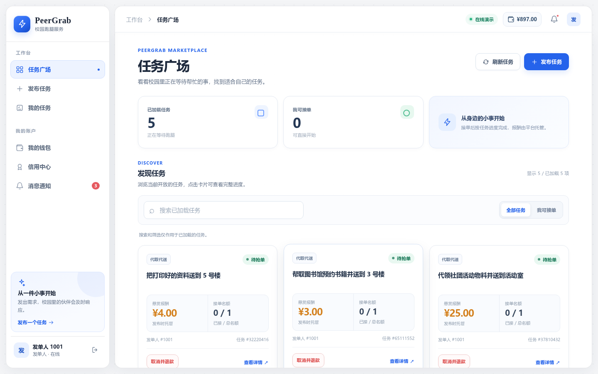
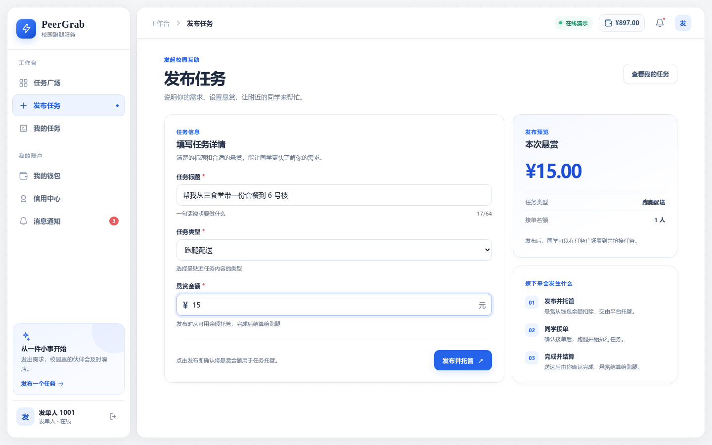
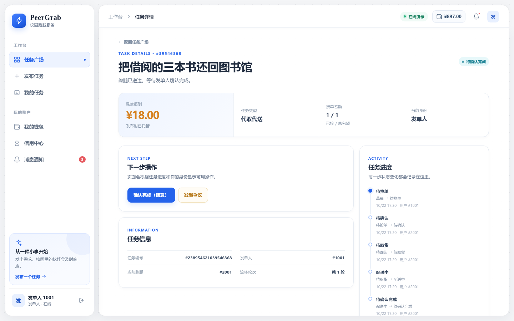
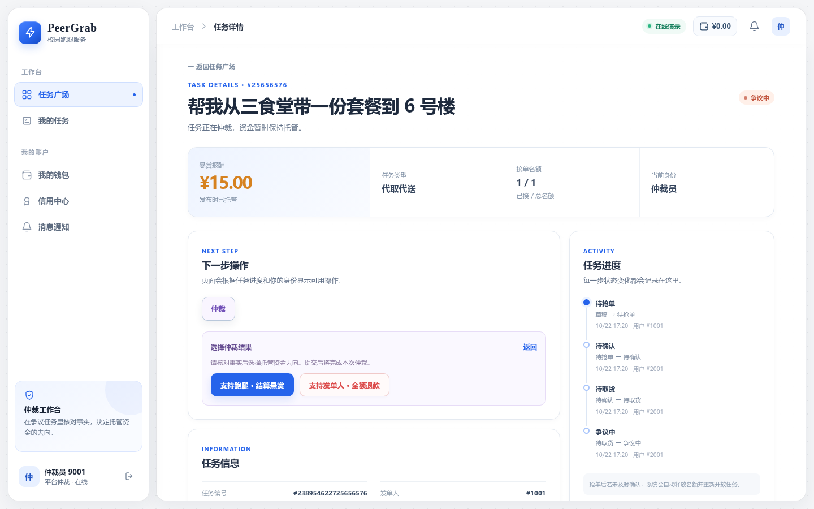
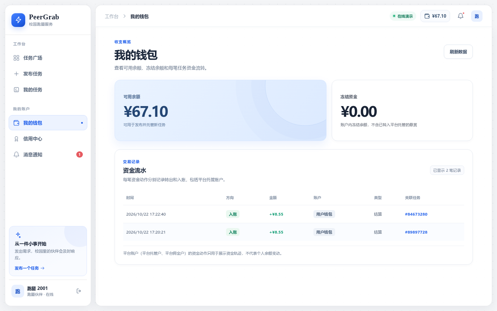
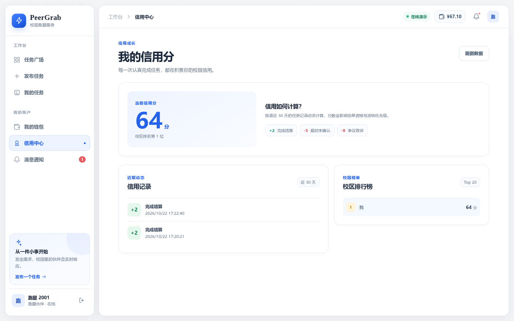
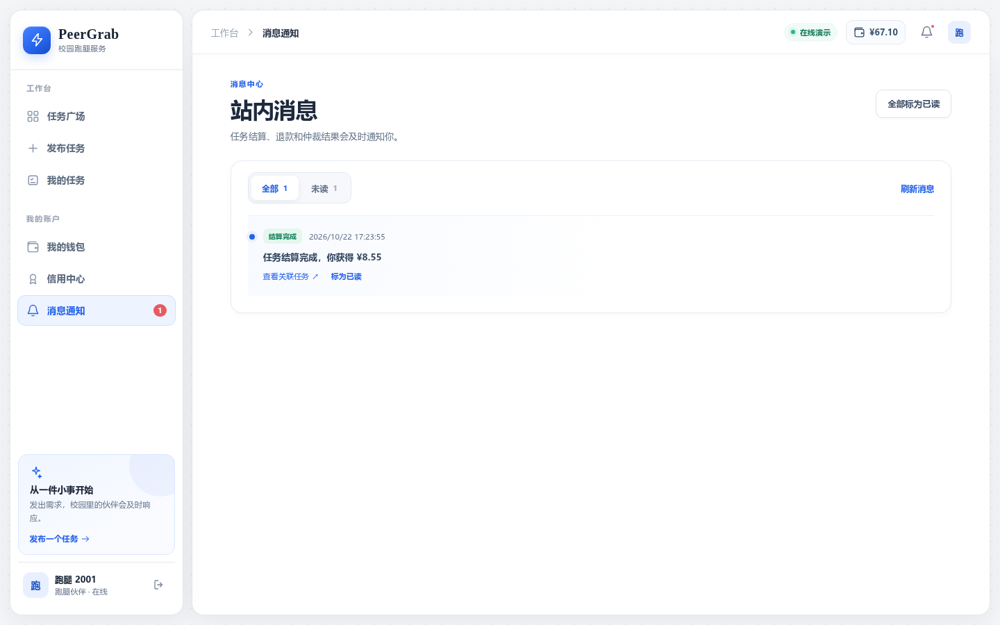
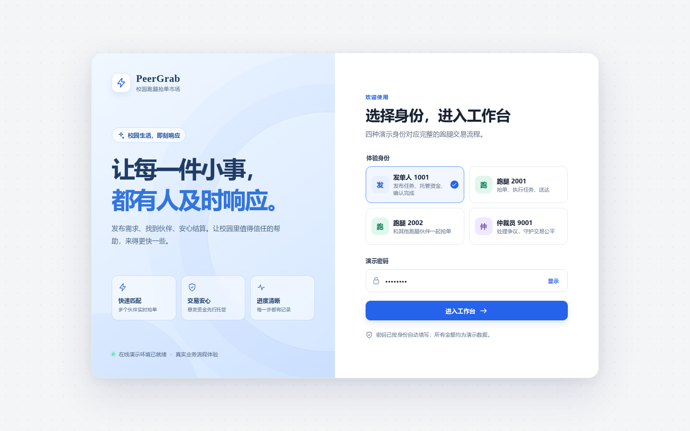
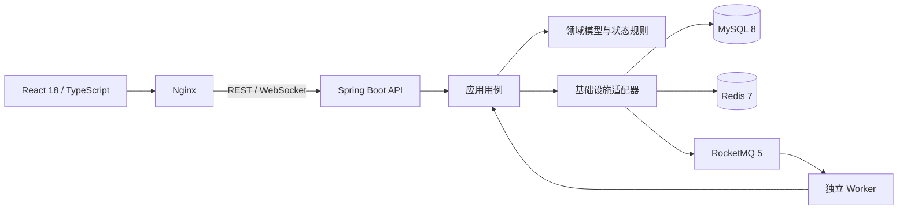

<p align="center">
  
</p>

<h1 align="center">PeerGrab</h1>

<p align="center">
  <b>校园里的 C2C 任务交易与履约平台</b><br/>
  发布任务 → 资金托管 → 抢单履约 → 结算 / 退款 / 仲裁，把一次互助跑成完整交易闭环
</p>

<p align="center">
  
  
  
  
  
  
  
  
</p>

<p align="center">
  
</p>

---

**PeerGrab 是一个可运行的 C2C 任务交易与履约演示平台。** 发单人发布任务并把赏金托管到平台，跑腿抢单、确认、取货、送达；平台按状态机推进，完成后结算，异常时退款或由仲裁员裁决。发布、资金、异步事件、通知与对账在同一条链路里闭环。

在线演示：<https://www.peergrab.cn> · 文档入口：[docs/README.md](docs/README.md) · 快速开始：[↓](#快速开始)

---

## 一场任务如何走完

**① 发布与托管**

填写任务标题、类型和赏金，提交后在同一个数据库事务里完成：任务落库、托管单创建、本任务托管账户开户、发单人扣款、复式分录写入。发单人余额不足时整笔回滚，不会留下半成品任务。

<p align="center">
  
</p>

**② 抢单与履约**

任务广场展示待抢任务与赏金。多人同时抢一个名额时，先用 Redis Lua 原子预占，再由 MySQL 状态/版本 CAS 与唯一索引最终裁决；Redis 异常时退回数据库裁决。抢中后依次确认、取货、送达，每一步都由后端状态机决定可执行动作。

<p align="center">
  
</p>

**③ 结算、退款与仲裁**

发单人确认完成即结算；取消则原路退款；争议进入仲裁，由仲裁员根据双方证据决定资金去向。资金流水、消息通知、信用分和任务时间线同步更新；结算与退款都可重复重试，不会重复入账。

<p align="center">
  
</p>

## 能力地图

<table>
<tr>
<td width="50%"><br/><b>钱包与流水</b> — 托管、结算、退款逐笔记账，余额与流水可对账</td>
<td width="50%"><br/><b>信用分</b> — 成交加分、超时/争议扣分，影响抢单资格与排名</td>
</tr>
<tr>
<td width="50%"><br/><b>站内消息</b> — 结算、退款、递补结果持久化通知，WebSocket 实时推送</td>
<td width="50%"><br/><b>身份与角色</b> — 发单人 / 跑腿 / 仲裁员三端工作台，演示密码一键切换</td>
</tr>
</table>

## 核心设计

| | |
|---|---|
| **发布即托管** | 任务、托管单、账户扣款与复式记账在同一 MySQL 本地事务提交；金额以整数分存储，不引入浮点误差。 |
| **一单一户** | 每个任务拥有独立的托管户与佣金户，把资金锁粒度从“全局系统户”降到任务级；结算、退款、仲裁和批量结算只读写本任务账户。 |
| **抢单防超卖** | Redis Lua 原子预占削峰，MySQL 状态/版本 CAS 与唯一索引最终裁决；Redis 不可用时数据库仍能兜底。 |
| **状态机驱动交互** | 领域层约束任务状态，后端按状态和身份计算 `availableActions`，前端只渲染后端允许的动作，不另写一套规则。 |
| **持久幂等抢单请求** | 抢单先落 `grab_request`（requestId、payload hash、租约、轮次），同键重放返回同一终态；崩溃后 Worker 按 `grab_record` 复核收敛为成功或过期，不靠猜。 |
| **可靠异步** | 超时递补、自动结算、资金事件先与业务同事务写入本地消息表 / Outbox，再由 Worker 投递或扫描补偿；消费端幂等。 |
| **缓存只加速** | 详情读使用 Cache Aside + 逻辑过期 + 互斥回填 + 布隆过滤防穿透；缓存不参与抢单与资金裁决，故障时回源或返回旧值。 |
| **资金对账** | 后台检查借贷平衡、每单账户快照与托管闭环；结算/退款同一业务号只允许入账一次。 |

## 架构



API 与 Worker 复用应用用例；领域层定义状态规则和端口，基础设施层实现 MySQL、Redis、RocketMQ 适配。资金链路基于单 MySQL 本地事务，跨进程一致性交给本地消息表 / Outbox；ArchUnit 在测试中检查依赖边界。

```text
peergrab-backend/
├── peergrab-domain/          领域模型、状态规则、仓储端口
├── peergrab-application/     发布、抢单、履约、结算、退款、仲裁用例
├── peergrab-infrastructure/  MySQL / Redis / MQ 适配器与对账
├── peergrab-presentation/    REST 控制器、鉴权与统一返回
├── peergrab-bootstrap/       Spring Boot API 启动与配置
├── peergrab-worker/          MQ 消费、定时任务、outbox 投递
└── docker/                   MySQL / Redis / RocketMQ / Nginx / Compose
peergrab-frontend/
├── src/pages/                广场、发布、我的任务、详情、钱包、信用、消息
├── src/components/           导航、任务卡、动作按钮、Toast、骨架屏
└── tests/                    mock UI、live smoke、截图与验收
```

## 技术栈

| | |
|---|---|
| **后端** | Java 21 · Spring Boot 3.5 · Spring JDBC · Sentinel · JWT |
| **数据与消息** | MySQL 8 · Redis 7 · RocketMQ 5 · 本地消息表 / Outbox |
| **前端** | React 18 · TypeScript · Vite 5 · WebSocket |
| **可观测性** | Micrometer · Prometheus · Actuator |
| **部署** | Docker Compose · Nginx |
| **测试与压测** | JUnit 5 · ArchUnit · Playwright · JMeter 5.6 |

## 快速开始

需要 Docker 与 Compose v2：

```bash
cd peergrab-backend/docker
cp -n .env.example .env
docker compose -f docker-compose.yaml -f docker-compose.full.yaml --env-file .env up -d --build
```

打开 <http://127.0.0.1:25173>。演示身份（密码见 `.env`）：

| 身份 | 账号 | 密码 |
|---|---|---|
| 发单人 | `1001` | `demo1001` |
| 跑腿 | `2001` / `2002` | `demo2001` / `demo2002` |
| 仲裁员 | `9001` | `demo9001` |

API 健康检查：<http://127.0.0.1:28080/api/health>。已有 `peergrab-local` 数据卷请先按[本机卷升级步骤](peergrab-backend/README.md#已有本机-peergrab-数据卷升级)执行迁移，不要直接复用旧库。

## 怎么验证它真的能跑

```bash
# 后端单测（不需要中间件）
cd peergrab-backend && mvn -B -ntp test

# 后端全量：单元 + 真实 MySQL/Redis IT
mvn -B -ntp -Dpeergrab.it=true clean test

# 前端构建 + mock UI 契约回归
cd ../peergrab-frontend
npm ci
npm run build
python3 tests/ui_smoke.py --dist dist

# 真实浏览器链路 / 真实 API+MQ（只连可丢弃隔离栈）
python3 tests/live_smoke.py --base http://127.0.0.1:25173 --api-base http://127.0.0.1:28080
python3 tests/live_api_smoke.py --base http://127.0.0.1:28080 --timeout-flow --auto-settle-flow
```

当前基线：**332 项后端测试，0 失败、0 错误、0 跳过；其中 85 项 IT 真实执行**（2026-10-28，含持久幂等抢单 v2 新增用例）。测试数量由 [`tools/summarize_tests.py`](peergrab-backend/tools/summarize_tests.py) 从同一批 surefire 报表汇总，CI 使用同一口径。

## 实测与边界

这些数字只代表注明的工具、负载窗口和隔离栈，不是生产容量或 SLA：

- **任务广场**：JMeter 500 目标 RPS × 180 秒 × 3 轮，实际开始 **269,608** 次请求，0 请求错误；最差轮客户端 P99 **255 ms**。
- **同单抢名额**：2,000 个 JMeter 用户线程同抢 1 个名额，恰好 **1 人成功、0 超卖**。
- **资金正确性**：200 并发重复结算只入账一次；1,000 单同刻到期最终排空，无重复结算；Broker 暂停窗口内 32 笔结算全部成功。
- **结算吞吐**：旧共享系统户模型下 200 单 / 32 线程短批次约 **32–39 TPS**（历史口径）；改为每任务独立账户后，本机隔离 IT 500 任务 / 64 线程单笔结算约 **118–119 TPS**。两者负载和环境不同，不能直接算提升倍数，也没有做 ECS 复测。

> 截图来自本地 Compose 真实栈，数据是一次性演示任务，不是生产数据；页面里的余额和任务与截图生成时的本地库一致。

## 这个仓库里没有什么

- **没有真实支付/托管资质**：全程虚拟资金，不接真实支付渠道，不构成二清或持牌托管能力。
- **没有生产级高可用**：单机 MySQL / Redis / RocketMQ 演示栈，没有多可用区、跨城容灾和长期稳定性验证。
- **没有自助注册**：只保留四个固定演示身份，方便复现完整业务链路。
- **没有密钥**：`.env` 与任何口令都不进版本控制；仓库只保留 `.env.example`。
- **没有生产运营后台**：当前聚焦交易、资金、异步和前端工作台，运营/风控/清结算后台不在范围内。

## 工程文档

- 文档唯一入口：[docs/README.md](docs/README.md)
- 设计基准与取舍：[design-benchmark](docs/architecture/design-benchmark.md)
- 账户拓扑与迁移：[wallet-account-topology](docs/architecture/wallet-account-topology.md)
- 工程演进与踩坑：[design-evolution](docs/engineering/design-evolution.md)
- 压测方法与历史报告：[benchmark/methodology](docs/benchmark/methodology.md)

## 截图

所有页面截图都在 [`docs/assets/screenshots/`](docs/assets/screenshots/)：桌面 1440×900，包含登录、广场、发布、详情、钱包、信用、消息、仲裁；另有三张 390×844 移动端截图。
