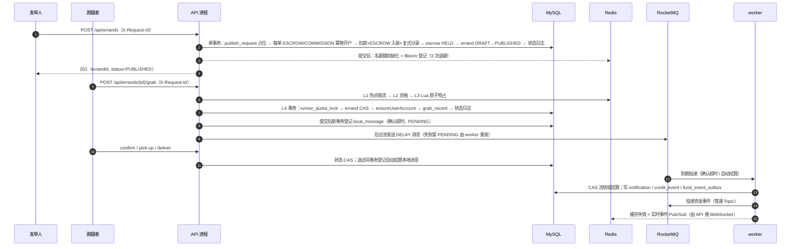
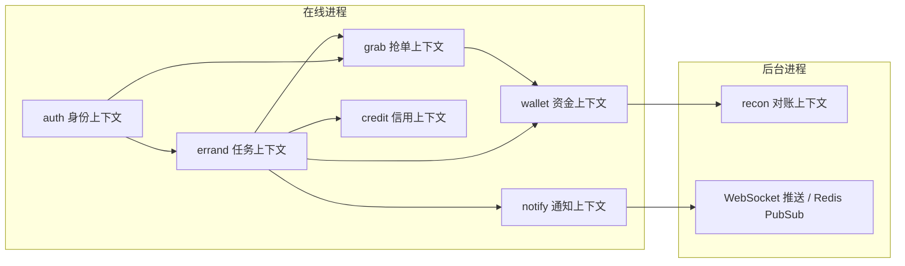
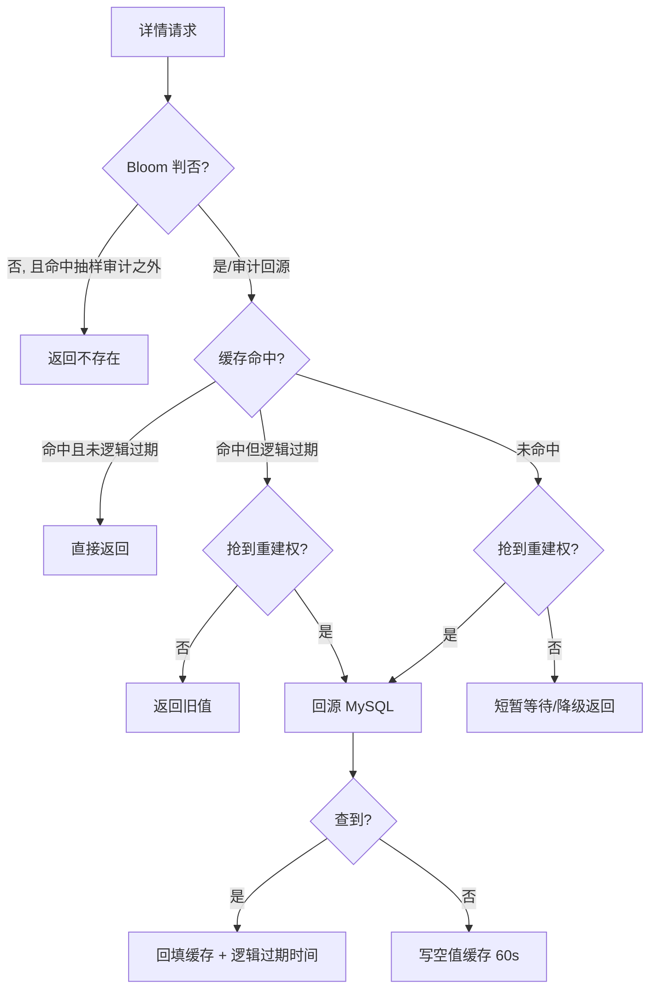
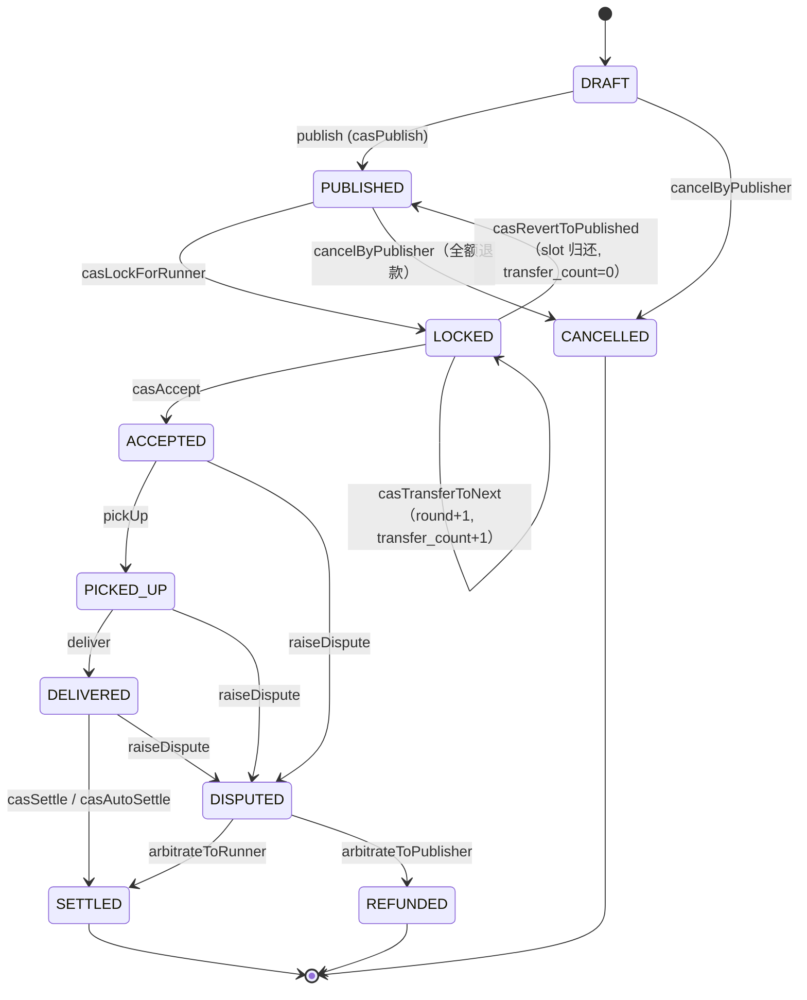

# PeerGrab 设计基准

> 本文是 PeerGrab 的**设计基准（design benchmark）**：把"为什么这样做、落在哪段代码、代价是什么、什么不做"写成可被复核的条目。
> 口径纪律：只写当前代码能核对到的事实；数字必须带工具、环境与统计窗口；没测过的写 `[待补充]`，不写计划态结论。
> 对应代码：`peergrab-backend/` 工作区（10 个 Maven 模块，其中 `peergrab-bench`、`peergrab-sharding-lab`、`peergrab-txmsg-lab` 为不进入运行包的离线模块；事务消息协议仿真见 [messaging-consistency.md](messaging-consistency.md)）。

## 0. 文档定位与阅读约定

### 0.1 这份文档回答什么

PeerGrab 已有三类文档：架构结论（[架构设计与技术选型.md](架构设计与技术选型.md)）、配置清单（[config-reference.md](config-reference.md)）、问题与修复记录（[PeerGrab 全面深度分析报告](../analysis/PeerGrab-全面深度分析报告.md)）。它们分别回答"是什么""怎么配""哪里错过"，**都不回答"为什么不是另一种做法"**。

设计基准补的就是这一段：每条主链路先给不变式，再给代码落点，再给候选方案矩阵（含"为什么不够"），最后主动认账边界。它面向三类读者：

| 读者 | 想解决的问题 | 建议读法 |
| --- | --- | --- |
| 维护者 | 改这里会不会破坏某个不变式 | 先读 §3–§6 的"不变式 → 代码落点"，再读 §8 的索引与 CAS 清单 |
| 评审/面试官 | 这些机制是抄的还是想过的 | 读每个小节的方案演进矩阵与"边界与已知代价" |
| 写作者 | 数字与类名到底以哪份材料为准 | 读 §9 指标口径表与 §12 事实源优先级 |

### 0.2 与其它文档的关系

| 文档 | 回答的问题 | 与本文的关系 |
| --- | --- | --- |
| [架构设计与技术选型.md](架构设计与技术选型.md) | 系统由哪些模块组成、选了什么技术 | 结论层；本文是它的论证展开。两处冲突时以本文的代码落点为准，并回改前者 |
| [config-reference.md](config-reference.md) | 每个 `peergrab.*` 键的默认值与生效进程 | 本文只引用键名与关键取值，不复制默认值表；共享键一致性见该文"共享键矩阵" |
| [PeerGrab 全面深度分析报告](../analysis/PeerGrab-全面深度分析报告.md) | 曾经有哪些问题、修了什么 | 本文把其 §9/§10 的修复记录当作"已解决"的证据引用，不重复叙述缺陷细节 |
| [压测运行手册](../../peergrab-backend/bench/README.md) / [评测方法论](../benchmark/methodology.md) | 数字怎么测出来的 | 本文 §9 只引用结果与窗口，不重新解释方法论 |
| [设计演进](../engineering/design-evolution.md) | 方案是怎么一步步变成现在这样的 | 本文给"当前态 + 候选方案"，演进叙事在那篇 |
| [wallet-account-topology.md](wallet-account-topology.md) | 每单 ESCROW/COMMISSION 账户的动机、模型、锁序、收益/代价、迁移与回滚 | 本文 §5.1–§5.6 的账户口径以该 ADR 为决策记录 |

### 0.3 四条写作纪律

1. **以代码为准**：类名、SQL 条件、表名、索引名、配置键都必须能在仓库里检索到。文档与代码冲突时先改文档，再决定是否改代码。
2. **不写计划态**：未接线的能力必须显式标注"未接线/离线验证"，例如分片规则只在 `peergrab-sharding-lab` 里跑测试，运行链路仍是单库。
3. **数字带标签**：任何吞吐/延迟数字必须能回答"哪个镜像、什么工具、多大负载、多长窗口、错误分母是多少"。不同工具的数字不合并。
4. **边界写成条目**：不写"基本满足"，写"满足到哪、哪里会退化、退化后靠什么兜底"。

### 0.4 事实核查方法（可复现）

```bash
# 1) 表与唯一索引：22 张表、唯一键清单
grep -n "CREATE TABLE\|UNIQUE KEY" peergrab-backend/docker/init.sql

# 2) 抢单终裁 SQL：状态 + 版本 + 名额三条件
grep -n "casLockForRunner" -A 14 peergrab-backend/peergrab-infrastructure/src/main/java/com/peergrab/infrastructure/persistence/JdbcErrandRepository.java

# 3) 配置键总量：@Value 读取的键 vs 仅 @ConditionalOnProperty 的开关
grep -rhoE '\$\{peergrab\.[a-zA-Z0-9._-]+' --include=*.java peergrab-backend | sort -u | wc -l
```

## 1. 项目定位、角色与主链路

### 1.1 定位

PeerGrab 是**校园跑腿悬赏交易平台**：发单人发布悬赏并同步托管资金，跑腿者竞争唯一名额，履约后结算，取消走退款，争议由仲裁员二元裁决。它的技术内核不是"跑腿业务"，而是三件事的组合：

1. **发布即托管**：任务、本任务一对 ESCROW/COMMISSION 账户、托管单、扣款、复式分录在同一个 MySQL 本地事务里提交（`PublishErrandUseCase`）。
2. **并发抢单的零超卖**：Redis Lua 预占削峰 + MySQL CAS 与双唯一索引终裁（`GrabErrandUseCase` / `GrabTransactionalStep`）。
3. **可补偿的异步**：延迟消息主通道 + 本地消息表/outbox + 数据库扫描兜底，MQ 故障时资金事务照常提交（`local_message` / `fund_event_outbox`）。

它是**模块化单体 + 双进程**，不是微服务；是**演示/教学定位的完整实现**，不是持牌资金系统。这个定位决定了 §11 "明确不做什么"。

### 1.2 角色

| 角色 | 身份来源 | 关键约束 | 代码落点 |
| --- | --- | --- | --- |
| 发单人（演示 `1001`） | token；生产为 MySQL 真值 JWT，本机演示为 Redis Session | 只能发布、取消、确认结算、发起争议；不能抢自己的单 | `PublishErrandUseCase.publish`、`Errand.publisherId` 校验、`SELF_GRAB_FORBIDDEN` |
| 跑腿者（演示 `2001`/`2002`） | 同上 | 信用分 ≥ `credit.min-score`、在途任务 < `credit.max-ongoing`、同一轮只能占一个名额 | `GrabErrandUseCase`、`grab_record` 双唯一索引 |
| 仲裁员（演示 `9001`） | 配置 `peergrab.auth.arbitrator-id` | 禁止发布与抢单；不得是争议当事人 | `ActorRolePolicy.requireTradable` / `isArbitrator`、`ArbitrateErrandUseCase` |

**没有用户表**：身份来自 token，钱包账户按需幂等开通（`WalletRepository.ensureAccount`：`USER` 账户按用户 ID；`ESCROW`/`COMMISSION` 账户按 `errandId`，每任务一对）。这是整个数据模型里最容易被误读的一点——"用户"在这里只是 ID 加上若干幂等登记。

### 1.3 主链路时序



### 1.4 异常分支

| 分支 | 触发 | 资金结果 | 代码落点 |
| --- | --- | --- | --- |
| 取消退款 | `PUBLISHED` 且无人接单 | 托管全额退回发单人，escrow → REFUNDED | `RefundErrandUseCase`、`casEscrowStatus` |
| 确认超时递补 | `LOCKED` 且 `confirm_deadline_at <= NOW(3)` | 资金不动，只换人；连续 5 次后回退重开 | `TimeoutTransferUseCase.handleTimeout` |
| 自动结算 | `DELIVERED` 且 `auto_settle_deadline_at <= NOW(3)` | 托管 → 跑腿 + 佣金 | `SettleErrandUseCase.settle` / `settleAutoBatch` |
| 争议仲裁 | 三方任一状态下发起 | 资金原地冻结，裁决后单向释放 | `DisputeErrandUseCase`、`ArbitrateErrandUseCase` |
| 消息早到 | 自动结算消息早于数据库截止时间 | 不动账，返回 `NOT_DUE` 并 ACK | `SettleErrandUseCase.settle`、`AutoSettleConsumer` |

### 1.5 业务能力边界（能跑通的）

账户与钱包流水、发布与幂等、并发抢单、履约状态机、结算/退款/仲裁、超时治理、信用分、站内通知与 WebSocket、双鉴权实现、Prometheus 指标与三层对账、多套 Compose（本地基础/全栈/生产/多主机/压测/可观测 overlay）与单 ECS 部署脚本。这些能力都有对应代码与测试，不是规划项。

## 2. 限界上下文与模块边界

### 2.1 十个 Maven 模块

| 模块 | 职责 | 进入运行包 | 事实核对点 |
| --- | --- | --- | --- |
| `peergrab-shared` | 值对象（`Money`）、错误码、雪花 ID、MQ 消息协议、实时事件协议 | API 与 worker | `shared/RealtimeEvents`、`MessagePayloadCodec` |
| `peergrab-domain` | 状态机、聚合规则、25 个端口；纯 JDK | API 与 worker | `ArchitectureRuleTest` 禁止框架依赖 |
| `peergrab-application` | `usecase` 下 24 个类：发布、抢单、履约、结算、退款、仲裁、查询、校验 | API 与 worker | `application/usecase/**` |
| `peergrab-infrastructure` | JDBC、Redis（Lua/候选队列/榜单/缓存）、RocketMQ、Sentinel、鉴权适配器 | API 与 worker | `infrastructure/**` |
| `peergrab-presentation` | REST、WebSocket、DTO、鉴权入口、异常映射 | 仅 API | `ErrandController`、`GlobalExceptionHandler` |
| `peergrab-bootstrap` | API 进程装配、集成测试 | 仅 API | `peergrab-bootstrap/src/test/java/com/peergrab/it/**` |
| `peergrab-worker` | 超时扫描、自动结算、重发、对账、校准、保留清理（22 个类） | 仅 worker | `worker/*Job`、`*Consumer` |
| `peergrab-bench` | 压测客户端与探针 | 否 | `bench/**` |
| `peergrab-sharding-lab` | ShardingSphere 规则与路由策略离线验证 | 否 | `PeerGrabShardingPolicy`、`PeerGrabShardingRuleFactory` |
| `peergrab-txmsg-lab` | RocketMQ 事务消息协议仿真（内存 Broker + 三态回查）与 outbox 对照 | 否 | `InMemoryTransactionBroker`、`TransactionMessageLabTest` |

**为什么离线模块必须独立**：`peergrab-sharding-lab` 引入 ShardingSphere 5.x 依赖，`peergrab-txmsg-lab` 用内存 Broker 仿真协议、不需要真实 MQ。把它们放进 `bootstrap`/`worker` 会让运行包的依赖与启动路径都变重，还会让“未接线”的分片/事务消息能力看起来像已上线。隔离在独立模块里，测试可以跑，运行包不受影响。

### 2.2 上下文地图



七个领域包：`auth`、`credit`、`errand`、`grab`、`notify`、`recon`、`wallet`；端口共 25 个（`errand` 9、`grab` 4、`wallet` 4、`notify` 3、`auth` 2、`credit` 2、`recon` 1）。

上下文之间**不做同步 RPC**，只有两种通信方式：

1. **同库事务**：发布时 errand + 每单 ESCROW/COMMISSION 开户 + wallet + escrow 在一个事务里；结算时 errand CAS + escrow CAS + 本任务账户过账 + outbox 在一个事务里。
2. **异步事件**：资金事件 outbox → 普通 Topic → worker 落库通知 → Redis Pub/Sub → API 推 WebSocket。

这是"不拆微服务"的直接技术后果：只要上下文之间允许同库事务，就不需要分布式事务；一旦拆开，发布链路立刻变成 TCC/Saga 问题（见 §10）。

### 2.3 依赖方向与 ArchUnit 规则

| 规则 | 断言 | 代码 | 违反后的后果 |
| --- | --- | --- | --- |
| R1 领域无框架 | `domain` 不得依赖 Spring/JDBC/RocketMQ/Redisson | `ArchitectureRuleTest.domain_should_be_framework_free` | 换中间件要改业务规则，六边形退化成三层 |
| R2 端口在领域 | `*Repository`/`*Port` 接口必须位于 `..domain..ports..` | `repository_ports_live_in_domain_ports` | 依赖倒置反转，infrastructure 变成被依赖方 |
| R3 模型不依赖端口 | `domain.model` 不得依赖 `domain.ports` | `model_should_not_depend_on_ports` | 聚合知道自己怎么被持久化，领域规则被存储细节污染 |

依赖方向固定为 `presentation`/`bootstrap`/`worker` → `application` → `domain`，`infrastructure` 实现 `domain` 的端口。`@Transactional` 的边界画在 application 层，且必须拆成独立 Bean（`GrabTransactionalStep`、`TimeoutTransferStep`），否则同类自调用会绕过代理——这条在代码注释里被反复解释，因为它真的踩过。

### 2.4 双进程装配差异

| 维度 | API（`peergrab-bootstrap`） | worker（`peergrab-worker`） |
| --- | --- | --- |
| 端口 | `server.port=8080` | `server.port=8082` |
| 雪花节点 | `peergrab.worker-id=1` | `peergrab.worker-id=2` |
| WebSocket | `ws.enabled=true`，直接持有连接 | `ws.enabled=false`，装配 `RedisFanoutRealtimeNotifier` |
| MQ 角色 | 生产延迟消息（超时/双删） | 消费延迟消息与资金事件，重发 PENDING |
| 调度池 | 无 Spring 调度池 | `fast`/`maintenance`/`mqConsumer`/`mqSend` 四池 |
| readiness | `readinessState,db,redis,snowflakeLease` | 追加 `workerScheduler` |
| 连接池 | Hikari 20 | Hikari 10 |

两个进程复用同一套 application/domain，只换适配器与调度器。这带来一个必须守住的纪律：**共享键必须两边一致**，例如 `settle.commission-rate`、`timeout.confirm-seconds`、`mq.topic.*`。门禁是 `SharedConfigConsistencyTest`（解析两份 yaml、对交集键做值相等断言），说明见 [config-reference.md](config-reference.md)。

## 3. 链路 L1：抢单（N 抢 1）

### 3.1 不变式

| 编号 | 不变式 | 违反时的现象 | 本项目防线 |
| --- | --- | --- | --- |
| INV-1 | 同一轮内抢中人数 ≤ 名额数（当前 `slot_total=1`） | 两人都以为自己接到同一单，履约与结算二选一必错 | `errand` CAS 的 `slot_taken < slot_total`、`grab_record.uk_errand_round_seq`、`ck_slot` CHECK |
| INV-2 | 同一轮内同一用户最多占一个名额 | 一人多端刷单 | `grab_record.uk_errand_round_user` |
| INV-3 | 同一请求重复提交只生效一次 | 网络重试造成重复占位/重复扣款 | `grab_record.uk_errand_request` + 按 `round` 回放真实结果 |
| INV-4 | 失败者能进候选队列且顺序稳定 | 递补找不到人，或顺序随机引发纠纷 | Redis ZSET + 租约 + `score = 时间戳 − 信用分×10ms`（上限 1 秒加权） |

INV-1 是硬约束，验收方式是"成功数严格等于名额数 + 数据库 SQL 复核"，不是"看起来没超卖"。

### 3.2 代码落点

| 阶段 | 代码 | 关键行为 |
| --- | --- | --- |
| 前置 | `GrabErrandUseCase.grab` | requestId 校验 → `ActorRolePolicy.isArbitrator` → 任务存在 → 自抢拒绝 → 幂等回放 |
| L1 限流 | `SentinelGrabRateLimiterAdapter`（或 `LocalGrabRateLimiterAdapter`） | 按 `errandId` 热点参数限流，默认 500/秒/实例，`grab.limit.*` |
| L2 资格 | `CreditRepository.scoreOf`、`ErrandQueryPort.countOngoingByRunner` | 信用分读后端 `credit_score`，客户端传分被忽略 |
| L3 预占 | `RedisGrabSlotAdapter` + `RedisLuaConfig` | hash tag 同槽、requestId 幂等、名额守恒、同用户防重、pending 窗口 |
| L4 终裁 | `GrabTransactionalStep.lockAndRecord` | `runner_quota_lock` → `casLockForRunner` → `ensureUserAccount` → `grab_record` → 状态日志 |
| 失败补偿 | `GrabErrandUseCase.rollbackIfReserved` / `healStaleRedisReservation` | 仅在确认未落库时回滚预占；DB 仍 PUBLISHED 时清理陈旧快照 |
| 观测 | `GrabPhaseMetrics` | 按阶段打点：限流、信用读、在途读、预占、DB 事务、回放、候选入队 |

终裁 SQL 一共四个条件，缺一不可：

```sql
UPDATE errand
   SET status='LOCKED', grabber_id=?, slot_taken=slot_taken+1,
       locked_at=NOW(3), confirm_deadline_at=DATE_ADD(NOW(3), INTERVAL ? SECOND),
       version=version+1
 WHERE id=? AND status='PUBLISHED' AND version=? AND slot_taken<slot_total;
```

`version` 让并发写互相排斥，`slot_taken<slot_total` 让"名额"成为 SQL 层的事实，而不是应用层的判断；`grab_record` 的两个唯一索引是"就算前面全被绕过也不会超卖"的最后一道。

### 3.2.1 持久幂等请求（v2，P12）

v1 的请求幂等只在“抢中落库后”可回放（`grab_record.uk_errand_request`）。v2 在同步链路外增加一层
数据库请求事实 `grab_request`：先登记 requestId（唯一作用域 + payload hash + 租约），再执行原四层链路，
最后把结果写回请求行。效果：

| 能力 | 实现 | 边界 |
| --- | --- | --- |
| 同 requestId 重放 | 终态行直接回放，`replayed=true`；内容不一致返回 `REQUEST_CONFLICT` | 终态不可重开，429/503 需换新 ID |
| 202 处理中 | 租约有效但结果未定时返回 202，客户端用 `GET /api/errands/{id}/grab-requests/{requestId}` 查询 | 需要前端配合轮询 |
| 崩溃恢复 | Worker 扫描租约过期的 PROCESSING：`grab_record` 证明已提交 → SUCCEEDED 并补副作用；否则 EXPIRED 并清理陈旧 Redis 快照 | 不能凭“没查到记录”推断成功 |
| 过期轮次 | 登记时记录 `expectedRound/baseErrandVersion`，执行前比对，过期即 `STALE_VERSION` | 客户端必须回传详情里的 round |

执行仍复用 `GrabErrandUseCase`：Redis Lua 预占、DB CAS、双唯一索引、候选队列、超时消息全部不变；
v2 只是把“请求生命周期”持久化。接口并存：v1 `/grab`、v2 `/grab-v2`，可独立回滚。

### 3.3 方案演进矩阵

| 方案 | 做法 | 为什么不够（本项目视角） |
| --- | --- | --- |
| A. JVM 锁（`synchronized`/`ReentrantLock`） | 方法级加锁 | 只在单进程有效；API 一旦多副本就各自持锁直接超卖。锁粒度还是整个方法，不同任务互相排队 |
| B. 数据库悲观锁 `SELECT ... FOR UPDATE` | 锁任务行再判断 | 正确但贵：热点任务把 2000 个请求全打到 DB，连接池与锁等待队列同时拉长；RR 下间隙锁还会引入死锁面 |
| C. 纯乐观锁 CAS | 只靠 `version` 更新 | 正确性够，但 1999 个失败请求每个都要写一次 DB；吞吐被无意义的写请求吃掉，热点时放大行锁竞争 |
| D. Redis `SETNX` 分布式锁 | 抢锁成功才走业务 | 锁过期与业务耗时赛跑、释放可能误删别人的锁；它保证"互斥"，不保证"名额守恒"——锁失效瞬间仍会超卖 |
| E. Redisson 看门狗 / Redlock | 自动续期 + 多节点投票 | 解决续期与误删，但主从切换仍可能丢锁；Redlock 把假设换了个地方而不是消除。对"名额守恒"这个目标仍然要 DB 兜底 |
| F. **Lua 原子预占 + DB CAS + 双唯一索引（终选）** | Redis 做单线程原子判定，MySQL 做唯一事实终裁 | 保留前者的吞吐（Redis 挡掉绝大多数无效请求）与后者的正确性（Redis 判错也不超卖）；代价是两套状态要能自愈（见 §3.4） |

矩阵里没有"消息队列串行化抢单"这一项，因为本项目**明确不需要**：串行化会把抢单变成单写者，吞吐上限被单消费者钉死，且引入额外延迟；"零超卖"用唯一索引就能表达，不需要排队。

### 3.4 边界与已知代价

1. **Redis 是可丢的**：生产 `allkeys-lru`，名额键可能被淘汰。此时 `SlotOutcome.SLOT_MISSING` 走 DB CAS，正确性不变，削峰能力下降。这是刻意选择：缓存/名额/榜单都可重建，唯一真值在 MySQL。
2. **预占残留**：Lua 成功但进程崩溃时，`grabbed` 集合可能残留。抢单路径在"DB 仍 PUBLISHED"时清理陈旧快照（`healStaleRedisReservation`），把最长 7 天的误判压到一次请求。
3. **pending 窗口**：`SLOT_FULL` 且存在并发预占位时返回 `GRAB_CONFLICT`，窗口约 10 秒；该分支不入候选队列，属于已知边界（见分析报告 §10.1）。
4. **单名额**：`PublishErrandUseCase` 显式拒绝 `slotTotal != 1`，因为托管单、确认窗口、当前跑腿都按"一个名额"建模。多名额是模型改造，不是配置项。
5. **候选队列容量与排序**：[待补充]。当前只有"时间戳 − 信用分×10ms"的启发式排序，没有压测过队列深度对递补时延的影响。
6. **限流是单实例语义**：Sentinel 规则在进程内，多副本时总放行量按副本数放大；它保护单实例，不保护集群。
7. **v2 与 v1 并存**：当前 `/grab` 与 `/grab-v2` 同时可用，切换期需要明确前端版本；禁止 v1/v2 写进程长期混跑，否则同一 requestId 的持久化位置不同、重放口径会分叉。

## 4. 链路 L2：超时递补与自动结算

### 4.1 规则与取值

| 规则 | 取值（默认） | 语义 | 代码/配置 |
| --- | --- | --- | --- |
| 确认期限 | 300 秒 | 抢中后必须确认，否则流转 | `timeout.confirm-seconds`，写入 `confirm_deadline_at` |
| 连续递补上限 | 5 次 | 达到上限不再逐个试候选人，直接回退重开 | `timeout.max-transfer-rounds`、`errand.transfer_count` |
| 候选取人 | ZSET + 30 秒租约 | 取不到候选或别人持租约时本轮跳过 | `candidate.lease-seconds`、`RedisCandidateQueueAdapter` |
| 自动结算期限 | 86400 秒 | 送达后 24 小时未确认则自动结算 | `settle.auto-settle-seconds` |
| 扫描周期 | 5 秒（宽限 2 秒） | 让 MQ 主通道先处理，扫描只补漏 | `timeout.scan-*`、`settle.scan-*` |
| 单轮预算 | 10 秒 / 30 秒 | 扫描与批量结算都有时间预算，不长期占调度线程 | `timeout.scan-max-run-ms`、`settle.scan-max-run-ms` |

### 4.2 幂等三件套（加一件）

| 编号 | 机制 | 防的是什么 | 代码 |
| --- | --- | --- | --- |
| I-1 | `version` CAS | 任务被任何操作改过，旧消息的 CAS 必然失败 | `casTransferToNext` / `casRevertToPublished` / `casSettle` |
| I-2 | `round` 校验 | A→B→A 轮回时，第 2 轮的消息误伤第 4 轮 | `handleTimeout(errandId, expectedRound)` |
| I-3 | `local_message.uk_msg_key` | 同一轮的超时消息被登记两次 | `TimeoutPolicy.msgKey(errandId, round)` |
| I-4 | `grab_record` 按 `round` 回放 | 幂等重放跨轮次误报"已抢中"（分析报告 §10 已修） | `findGrabbedByRequestId(campusId, errandId, requestId, round)` |

消息一定重复投递（at-least-once），所以每个动作都必须可重复执行——这不是"顺手加个幂等"，而是整条链路的设计前提。

### 4.3 代码落点

| 环节 | 代码 | 关键行为 |
| --- | --- | --- |
| 抢中后登记 | `GrabErrandUseCase.afterCommittedGrab` → `TimeoutTransferUseCase.scheduleFirstTimeout` → `TimeoutTransferStep.enqueueTimeout` | 独立事务写 `local_message`（PENDING），返回待发消息 |
| 即时投递 | `TimeoutMessageDispatcher` | 有界队列 + 独立线程池；队列满/不可用只计数（`deferred`），消息留 PENDING |
| 到期消费 | `TimeoutTransferConsumer` → `TimeoutTransferUseCase.handleTimeout` | 先查库复核状态与 round，再用数据库时钟判断是否真到期 |
| 递补事务 | `TimeoutTransferStep.transfer` | 额度行锁 → `casTransferToNext` → 补 `grab_record` → 状态日志（`LOCKED→LOCKED`） → 下一轮 `local_message` |
| 回退事务 | `TimeoutTransferStep.revert` | `casRevertToPublished`（`slot_taken-1`、`transfer_count=0`、`round+1`） → 扣信用分 → 站内消息 |
| 兜底扫描 | `TimeoutScanJob` / `AutoSettleScanJob` | 游标分页 + 时间预算；失败项先落 `worker_scan_retry` 再推进游标 |
| 重发 | `LocalMessageRetryJob`（`mqSendScheduler`，单轮 10 秒预算） | claim 租约 120 秒；指数退避到 5 分钟；1000 次后转 `DEAD` |
| 结算消费 | `AutoSettleConsumer` | `NOT_DUE`/`ALREADY_SETTLED`/`CONFLICT` ACK；状态已变的错误码分类 ACK 并告警，其余 `FAILURE` 重投 |

### 4.4 延迟队列方案矩阵

| 方案 | 做法 | 为什么不够 |
| --- | --- | --- |
| A. DB 轮询扫表 | 定时扫 `status='LOCKED' AND deadline < now` | 精度受扫描周期限制，周期短则 DB 压力大；本项目把它降级为**兜底通道**而非主通道 |
| B. Redis ZSET | 到期时间戳作 score，轮询取到期项 | 精度好，但宕机恢复、多副本竞争、消息可靠性都要自己实现；Redis 已被定义为可丢组件，不能承担"唯一通道" |
| C. 时间轮 | 进程内 `HashedWheelTimer` | 毫秒级精度但纯内存，重启全丢，跨进程不可用 |
| D. RabbitMQ TTL + DLX | 过期进死信队列 | 队头阻塞：一条 30 分钟的 TTL 消息会挡住后面 5 分钟的消息（除非用延迟插件） |
| E. **RocketMQ 5.x 定时消息（终选）** | `setDeliveryTimestamp` 任意时刻投递 | 可靠投递、消费组重试、无队头阻塞；代价是引入 Broker 依赖，且 topic 必须是 `DELAY` 类型 |

终选是 **E 主通道 + A 兜底扫描**："超时不流转"意味着任务永久卡在 `LOCKED`、资金永久冻结，所以不允许只有一条通道。主通道追求实时性，兜底通道追求不丢，两者用幂等三件套保证重复执行无副作用。RocketMQ 4.x 只有 18 个固定 delay level，满足不了"5 分钟精确投递"，这是选 5.x 的唯一硬理由（见 `RocketMqDelayMessageAdapter` 注释）。

### 4.5 边界与已知代价

1. **早到消息**：MQ 定时消息可能早于数据库截止时间到达。用例返回 `NOT_DUE`，消费者 ACK，由 5 秒扫描在到期后补上。这是"MQ 时间 ≠ DB 时间"的显式认账。
2. **`transfer_count` 与 `round` 分工**：`round` 只增（展示"第 N 轮"、做消息幂等），`transfer_count` 回退归零（做递补上限）。把两者合并会让"达到上限后候选永久失效"（分析报告 M1 的历史教训）。
3. **`DEAD` 之后没有自动处置**：`local_message` 重试 1000 次后转 `DEAD`，只暴露指标 `peergrab.delay.outbox.dead`，需要人工介入。当前没有死信重放工具。
4. **`worker_scan_retry` 无终态**：失败项无限重试（退避），避免误丢可恢复项；代价是长期失败项会一直占扫描名额。
5. **扫描分片后是全片广播**：扫描按 `status + deadline` 查，没有 `campus_id`，分片后必然广播所有分片；属于低频后台任务，当前接受。
6. **批量结算的取舍**：离线自动结算仍把一页 100 单合进一个事务（`settleAutoBatch`），但锁的对象已从两个全局系统户变成**本页每单自己的 ESCROW/COMMISSION 账户 + 收款跑腿的 USER 账户**，按账户 ID 升序一次锁齐；同页重复出现同一跑腿钱包、或与在线确认结算/退款撞上同一用户钱包时仍会等待。冲突时整页回滚（`BatchConflictException`），再由单笔幂等路径重放；在线确认结算（`settle`）与离线批量是两条独立路径，批量不改变单笔的三道闸门。新账户模型的批量结算尚无独立压测；§9 的本机 S4 IT（500 任务/64 线程、约 118–119 TPS）走的是单笔 `settle` 路径，不是 `settleAutoBatch`，两者不能混算。历史 32–39 TPS 见 §9 并带"共享系统户时期"标注。

## 5. 链路 L3：资金托管、结算与对账

### 5.1 账户模型

每个任务一对独立系统账户：`ESCROW`/`COMMISSION` 的 `owner_id` 都是 `errandId`。发布事务内用 `WalletRepository.ensureAccount(errandId, type)` 幂等开户（`uk_owner` 兜住重复/并发），结算/退款/仲裁/批量都只读写本任务的账户。

| 账户 | `owner_id` | 用途 | 不变量 |
| --- | --- | --- | --- |
| `USER` | 用户 ID | 用户可用余额 | `available >= 0`（`ck_balance`） |
| `ESCROW` | `errandId` | 本任务托管户，接收发单人转入的悬赏 | 余额 = 本任务 HELD 托管金额；结算/退款后归零 |
| `COMMISSION` | `errandId` | 本任务佣金户，结算/仲裁时入账平台佣金 | 余额 = 本任务已结算佣金（佣金为 0 时保持 0） |

金额一律 `BIGINT` 存**整数分**，不用 `DECIMAL`/`DOUBLE`；余额是快照，`wallet_ledger` 是事实来源；`uk_account_version(account_id, account_version)` 保证"账户版本 ↔ 流水"一一对应，`uk_biz_direction(biz_no, account_id, direction)` 保证同一业务同一账户同一方向只记一次。

**没有全局系统户**：`init.sql` 不再预置固定 `-1`/`-2` 账户，运行代码里也没有 `ESCROW_ACCOUNT_OWNER`/`COMMISSION_ACCOUNT_OWNER` 常量；旧库中的 `-1`/`-2` 两行只作为历史/迁移数据保留，新代码不再读写。迁移细节见 [账户拓扑 ADR](wallet-account-topology.md)。

**只转移不冻结**：`WalletAccount` 只做余额转移，不做预授权冻结。发布时钱从发单人转到本任务的 `ESCROW`，结算时从本任务 `ESCROW` 转给跑腿与本任务 `COMMISSION`；退款、仲裁同理，资金动作闭环在本任务账户内。这是担保交易（转移）而不是预授权（冻结）的建模选择，注释里记录了修正过程。

### 5.2 三道闸门与锁序

| 闸门 | 断言 | 代码 |
| --- | --- | --- |
| G1 任务状态 CAS | `DELIVERED → SETTLED` 只有一个线程成功 | `casSettle` / `casAutoSettle` |
| G2 托管单 CAS | `HELD → RELEASED` 只有一个线程成功 | `casEscrowStatus(campusId, errandId, HELD, RELEASED)` |
| G3 账本唯一键 | `biz_no='settle:{errandId}'` 重复插入撞唯一索引 | `WalletPosting.post`、`wallet_ledger.uk_biz_direction` |

三道闸门互相独立：即使前一道被绕过（理论上不可能），后一道仍会拒绝。锁序上，资金终态一律"先锁任务、再锁托管单"，多账户过账按账户 ID 升序 `SELECT ... FOR UPDATE`（`ORDER BY id`），消除 A→B 与 B→A 的环。

结算/退款/仲裁/批量路径的 `ensureUserAccount` 仍刻意放在事务外：ODKU 对已存在行取 X 锁，若放在事务内、其它钱包账户加锁之前，会形成 `wallet→escrow` 与 `escrow→wallet` 的环（分析报告 §10 已修）。发布路径只对发单人 USER 账户做存在性校验，并在同一事务内用 `ensureAccount(errandId, …)` 创建本任务的 ESCROW/COMMISSION——它们是全新行，其它事务尚不可见，不会与已有账户形成环。抢单事务内仍保留 `ensureUserAccount`，因为它的位置在额度锁与任务 CAS 之后（`quota → errand → wallet`）。佣金用 `BigDecimal` 十进制计算后向下取整，余数归跑腿，保证"跑腿 + 佣金 == 托管"恒等。

**每单账户改变了争用面，但没有消除钱包竞争**：结算/退款/仲裁只锁本任务的 ESCROW/COMMISSION 与相关用户钱包，不再有"所有结算排队等 `-1`/`-2` 两行"的全局串行点；剩下的竞争点是同一跑腿/发单人的 USER 账户（一个跑腿多单、在线结算与退款并发、`shared` 压测模式）与批量页内重复出现的用户钱包（§5.6）。

### 5.3 四个资金动作的事务边界

| 动作 | 同一事务内 | 事务外/提交后 | 代码 |
| --- | --- | --- | --- |
| 发布 | 本任务 ESCROW/COMMISSION 开户、扣款分录、本任务 ESCROW 入账、`escrow_order` HELD、`errand` DRAFT→PUBLISHED、`publish_request` 完成 | 名额键、Bloom、缓存失效 | `PublishErrandUseCase.publish` |
| 结算 | `errand` CAS、`escrow_order` CAS、两条/三条分录、信用事件、`fund_event_outbox` | 审计、榜单、缓存、实时推送 | `SettleErrandUseCase.settle` |
| 退款 | `errand` CAS、escrow CAS、退款分录、outbox | 同上 | `RefundErrandUseCase` |
| 仲裁 | escrow CAS、按 favor 单向释放、outbox | 同上 | `ArbitrateSettleStep` |

提交后的副作用逐项 `try/catch` 并计数（`peergrab.settle.side_effect.failures`）：资金已提交的事实不能因为审计或推送失败而被误报为失败。

**在线/离线两条结账路径仍分离**：发单人确认走在线 `settle` 单笔事务；worker 的自动结算走 `settleAutoBatch` 的离线页事务（一页一个事务，锁本页各任务账户，冲突整页回滚交回单笔幂等重放）。两条路径共用同一套三道闸门与过账规则，但事务粒度不同。

### 5.4 消息一致性方案矩阵

| 方案 | 做法 | 为什么够/不够 |
| --- | --- | --- |
| A. 同步双写（先写库再发 MQ） | 业务提交后直接 `send` | 发送失败就永久丢事件；重试又可能重复；没有可查询的中间状态 |
| B. **本地消息表 / outbox（终选）** | 业务与消息同事务入库，worker claim 后投递 | "消息发没发出去"变成可查询的数据库状态；MQ 挂了钱也能动；代价是多两张表 + 两个 job |
| C. RocketMQ 事务消息 | 半消息 → 本地事务 → commit/rollback → 回查 | 少一张表、少一个 job，但资金可用性耦合 MQ 可用性；回查必须实现正确；与定时消息互斥 |
| D. CDC/binlog 订阅 | 监听账本变更再投递 | 需要额外组件与位点管理，延迟不可控；本项目已明确 ES/Canal 退出运行架构 |
| E. 只靠定时对账 | 不发事件，靠对账发现问题 | 通知与推送失去实时性；对账是兜底，不是通道 |

本项目选 B，理由与对照细节见 [messaging-consistency.md](messaging-consistency.md)：**资金动作不能被 MQ 可用性阻塞**，而 PeerGrab 是演示站，Broker 就在同一台 ECS 上。

### 5.5 对账与审计

| 层级 | 校验 | 差异主体 | 判定 |
| --- | --- | --- | --- |
| L1 | 全局 `SUM(DEBIT) == SUM(CREDIT)` | `GLOBAL` | 不为 0 即代码 bug |
| L2 | 每单系统账户（`ESCROW`/`COMMISSION`，`owner_id=errandId`）`available + frozen` == 该账户流水净额；用户户用"最新流水 vs 快照 + 版本" | 账户 ID | 账目对但余额显示错 |
| L3 | 每张 `RELEASED/REFUNDED` 托管单都有对应结算/退款流水；已终态任务不得仍有 HELD | `errand_id` | 托管闭环断裂 |

差异写 `recon_diff`，`uk_date_type_subject(check_date, check_type, subject)` 保证重复跑不产生重复记录；`recon_diff` 不被保留期任务删除（审计证据）。资金审计 `fund_audit_log` 用 `REQUIRES_NEW` 独立事务：资金回滚了审计也要留痕。

### 5.6 边界与已知代价

1. **每单账户消除了系统户热点，但没有消除全部钱包竞争**：结算/退款/仲裁不再锁全局 `ESCROW`/`COMMISSION`，系统户串行点消失；剩余竞争来自 ① 同一跑腿/发单人的 `USER` 账户（一个跑腿多单、在线结算与退款并发、`shared` 压测模式）② 批量页内重复出现的用户钱包（按账户 ID 升序一次锁齐，冲突整页回滚）③ 发布时发单人钱包。旧模型短批次 32.04–39.52 TPS 是**共享系统户时期**的实测（§9 带版本标注）。新模型本机 IT 的 S4-a（500 个不同任务、64 工作线程、单轮）观测约 118–119 TPS；这是本地隔离 MySQL/Redis 的 IT 观测，不是 ECS 稳态、也不是全站容量，旧数字不能与新数字混算。
2. **账户行随任务数增长**：每任务固定新增 2 行 `wallet_account`（ESCROW/COMMISSION）且不删除，`wallet_ledger` 同步增长；对账、账户查询与巡检成本随任务数上涨。当前没有账户归档/清理策略，也没有大账户量下的对账耗时实测 `[待补充]`。
3. **对账按账户**：L2 从"两个系统户"变成"逐个每单系统账户校验快照 == 流水净额"，账户越多扫描越大；语义不变——系统账户初始为 0，结算/退款后必须回到 0（见 [不变式文档](invariants-and-control-experiments.md) §1.6）。`verify_fund.sql` 口径不变。
4. **迁移要求**：新代码不再读写 `-1`/`-2`。旧库升级必须把在途 HELD 任务的托管余额迁到 `(errandId, ESCROW)` 账户并为 `(errandId, COMMISSION)` 建户，否则结算/退款会因查不到本任务账户而失败；迁移脚本、执行顺序（停写→备份→迁移→发布新版本）与回滚方式见 [单机部署说明](../../peergrab-backend/docker/ECS_DEPLOY.md) 与 [账户拓扑 ADR](wallet-account-topology.md)。旧行保留作历史，不做反向脚本。
5. **只有内部账账对账**：没有支付渠道回单、没有 T+1 外部对账、没有资金熔断。自建虚户不是持牌托管，存在二清边界，这是产品定位问题，不是实现缺陷。
6. **流水归属语义**：托管腿记 `user_id=发单人`，佣金腿记平台标记 `-2`（`PLATFORM_LEDGER_USER_ID`，只是流水归属标记，不是账户 owner）；接口用 `accountType`（`USER`/`ESCROW`/`COMMISSION`）标注，前端提示"平台账户动作不代表个人余额变动"。每单账户让系统账户流水能按 `ref_id=errandId` 归到具体任务。
7. **退款/仲裁的资金方向由 `ArbitrationFavor.fromWire` 严格解析**：非法值返回 `INVALID_ARGUMENT`，不再默认判给跑腿（历史 H3 已修）。
8. **秒级窗口仍存在**：延迟双删缩小但不消除缓存与 DB 的不一致窗口；资金链路不读缓存，所以影响的是展示而不是裁决。

## 6. 链路 L4：缓存与数据同步

### 6.1 读路径



四个关键设计：**逻辑过期**让热点 key 到期不阻塞；**互斥重建**（SET NX token）把回源收敛成一次；**返回旧值**把"缓存击穿"转成"可控陈旧"，而不是把几百个线程挂在锁上；**空值缓存**兜住布隆放行但确实不存在的 ID。

缓存键带 generation 与 shard 维度（`errand:detail:{id}:{generation}:{shard}`；单分片时退化为 `errand:detail:{id}:single`），整代写完才切 `:active` 指针，避免分片间新旧混杂；`cache.shards=1` 是当前默认，多分片只增写放大。

### 6.2 写路径与一致性

| 机制 | 作用 | 代码/键 |
| --- | --- | --- |
| 提交后删除 | 让下一次读回源 | `CacheEvictSupport.evictAfterCommit` |
| 延迟双删 | 覆盖"读回填与写并发"的窗口 | `cache.double-delete-ms=500`、`RocketMqCacheEvictAdapter`（有界发送池，失败计数） |
| 抽样校验 | 主动发现不一致并修正 | `CacheConsistencyCheckUseCase`（含负值/空值缓存核对）、`sync_diff` |
| Bloom 判否 | 防穿透 | `bloom-enabled`、`bloom-audit-denominator=100`、`bloom-refresh-interval-ms=1800000` |
| 本地降级 | Redis 故障时短期复用已验证详情 | `cache.local-fallback-ttl-millis=1000`、`local-fallback-max-entries=10000` |
| 失效通知 | 跨实例失效 | `errand-cache-evict` 延迟 Topic |

**身份相关字段不进共享缓存**：`role`/`availableActions` 由服务端按当前请求身份计算，避免缓存串号。这是"缓存只放公共展示数据"的边界。

### 6.3 缓存策略矩阵

| 策略 | 做法 | 为什么不够 |
| --- | --- | --- |
| A. Cache Aside 只删不双删 | 写后 `DEL` | 读回填与写并发时，旧值可能被重新写回；窗口虽小，热点任务上会真实发生 |
| B. 双写（写库同时写缓存） | 更新 DB 再 `SET` 缓存 | 两次写非同事务，失败一半就长期不一致；并发写还会互相覆盖 |
| C. Read/Write Through | 缓存层代理 DB | 需要额外的缓存服务抽象，且"写穿透"仍然是同步双写，问题没消失 |
| D. Write Behind | 先写缓存异步刷库 | 资金与状态不能接受丢写；本项目连"缓存参与裁决"都明确禁止 |
| E. **Cache Aside + 逻辑过期 + 互斥重建 + 空值 + 抖动 + 延迟双删 + 校验 job（终选）** | 主动堵已知窗口 + 被动 TTL 兜底 + 独立监工 | 复杂度高，但每一层都能说出堵的是哪个窗口；代价见 §6.4 |
| F. binlog/CDC 同步（ES/Canal） | 用 binlog 做秒级纠偏 | 需要额外组件与位点运维；本项目已让 ES/Canal 退出运行架构，一致性靠失效 + TTL + 校验任务 |

### 6.4 边界与已知代价

1. **延迟双删是缩小窗口，不是消除**：500ms 内的读写竞态仍有极小概率留下旧值，靠 TTL 与校验任务兜底。
2. **冷 miss 有等待上限**：详情冷 miss 每请求最多等待约 50ms 抢重建权，超时降级；这是容量参数，属压测项。
3. **Bloom 只能判否**：判否短路依赖"索引完整"；发布登记 3 次退避 + 30 分钟全量校准 + 1% 判否抽样审计共同兜底，仍存在极短误判 404 窗口（分析报告 H4 的修复即为此）。
4. **缓存分片未验证**：`cache.shards` 默认 1，多分片路径没有压测数据 `[待补充]`。
5. **一致性校验是抽样**：`cache.check-sample-size=100`，不是全量比对；全量核对会打爆 Redis 与 DB。

## 7. 横切：身份、鉴权与实时推送

### 7.1 鉴权方案矩阵

| 方案 | 做法 | 为什么够/不够 |
| --- | --- | --- |
| A. 纯 Redis Session | 登录写 Redis，每请求查 Redis | 实现最简；但 Redis 故障即全员掉线，且 Redis 已被定义为可丢组件 |
| B. 纯无状态 JWT | 签名自证，不查库 | 无法即时吊销：登出、改密、封禁都要等 token 过期；refresh 轮换也无处落撤销标记 |
| C. **JWT + 服务端会话真值（生产终选）** | token 只带 `sid`，`auth_token_session` 是撤销真值 | Redis 故障仍能校验已签发令牌，登出即时生效；代价是每请求查一次 MySQL（`resolve-cache-ms` 本地缓存缓解） |
| D. OAuth2 / 统一 SSO | 接外部 IdP | 演示项目没有 IdP，接入是部署与合规问题，不是当前链路问题 |
| E. 信任网关注入的身份头 | `X-User-Id` 直通 | 只要有一层没覆盖就变成任意冒充；`auth.allow-header-identity` 生产必须 `false`，IT 有专门断言 |

### 7.2 代码落点与边界

| 项 | 落点 | 说明 |
| --- | --- | --- |
| JWT 校验 | `JwtAuthAdapter.resolve` | 查 `auth_token_session`（未撤销、未过期），本地正结果缓存 `auth.resolve-cache-ms=1000` |
| 刷新令牌 | `auth_refresh_token` | 256 位随机、只存 SHA-256、一次一用轮换（`uk_auth_refresh_session`） |
| 演示登录 | `DemoLoginPolicy`、`LoginAttemptGuard` | 常量时间比较；失败按 IP+userId 限速（5 次/60 秒，锁 300 秒），仅可信代理解析 `X-Forwarded-For` |
| 角色 | `ActorRolePolicy` | 仲裁员禁止发布/抢单；仲裁用例二次校验当事人 |
| 实时推送 | `WsHandler`、`WsSessionRegistry`、`WsAuthHandshakeInterceptor`、`RedisFanoutRealtimeNotifier` | 握手校验 token + Origin 白名单；推送前复核会话；单用户 8 连接、单连接 5 条/秒；`1008` 鉴权失败 vs `1013` 限流 |

边界：① JWT 实为有状态会话，每请求查 MySQL，MySQL 是鉴权热点；② 登录限速是进程内计数，多 API 副本时降级为"每副本限速"；③ 公开演示口令与 `9001` 仲裁员仅用于演示，生产必须关闭 demo。

## 8. 状态机与数据模型

### 8.1 状态机



`LOCKED → LOCKED` 是合法自环，靠 `round` 区分轮次；`LOCKED → PUBLISHED` 是超时回退。`ErrandStatus` 只声明"状态允许去哪"，身份与前置条件由聚合方法（`lockBy`/`acceptByRunner`/`settle`…）二次校验，两者必须同时满足。

### 8.2 迁移与 CAS 清单

| 迁移 | 方法 | CAS 条件（除 `id`） | 附带写入 |
| --- | --- | --- | --- |
| DRAFT→PUBLISHED | `casPublish` | `status='DRAFT' AND version=?` | `version+1` |
| PUBLISHED→LOCKED | `casLockForRunner` | `status='PUBLISHED' AND version=? AND slot_taken<slot_total` | `grabber_id`、`slot_taken+1`、`locked_at`、`confirm_deadline_at` |
| LOCKED→ACCEPTED | `casAccept` | `status='LOCKED' AND grabber_id=? AND version=?` | `version+1` |
| LOCKED→LOCKED | `casTransferToNext` | `status='LOCKED' AND version=? AND round=? AND confirm_deadline_at<=NOW(3)` | `grabber_id`、`round+1`、`transfer_count+1`、新截止时间 |
| LOCKED→PUBLISHED | `casRevertToPublished` | 同上 | `slot_taken-1`、`round+1`、`transfer_count=0`、清空截止时间 |
| DELIVERED→SETTLED | `casSettle` / `casAutoSettle` | `status='DELIVERED' AND version=?`（自动结算追加 `auto_settle_deadline_at<=NOW(3)`） | `version+1` |
| DISPUTED→SETTLED/REFUNDED | `casSettleFromDispute` / `casRefundFromDispute` | `status='DISPUTED' AND version=?` | `version+1` |
| HELD→RELEASED/REFUNDED | `casEscrowStatus` | `campus_id=? AND errand_id=? AND status='HELD'` | `status` |

### 8.3 22 张表的分类

| 分组 | 表 | 作用 |
| --- | --- | --- |
| 任务与履约（6） | `errand`、`errand_status_log`、`grab_record`、`escrow_order`、`runner_quota_lock`、`publish_request` | 状态机、抢单事实、托管单、额度锁、发布幂等 |
| 资金与账务（4） | `wallet_account`、`wallet_ledger`、`fund_audit_log`、`recon_diff` | 余额快照、复式流水、审计、对账差异 |
| 可靠异步（3） | `local_message`、`fund_event_outbox`、`worker_scan_retry` | 延迟消息、资金事件、扫描失败重试 |
| 身份（2） | `auth_token_session`、`auth_refresh_token` | 撤销真值、刷新令牌哈希 |
| 信用/通知/投影（4） | `credit_score`、`credit_event`、`notification`、`sync_diff` | 信用快照与事件、站内消息、缓存差异 |
| 运行时与评测（3） | `snowflake_node_lease`、`bench_run`、`bench_run_item` | 雪花租约与时间栅栏、压测轮次元信息 |

### 8.4 关键唯一索引

| 表 | 唯一索引 | 语义 |
| --- | --- | --- |
| `publish_request` | `PK(publisher_id, request_id)`、`uk_publish_errand(errand_id)` | 同一发单人同一键只发布一次；一个任务只有一条发布登记 |
| `grab_record` | `uk_errand_round_seq(errand_id, round, seq)` | INV-1：同一轮同一名额只被占一次 |
| `grab_record` | `uk_errand_round_user(errand_id, round, runner_id)` | INV-2：同一轮同一人只占一个名额 |
| `grab_record` | `uk_errand_request(errand_id, request_id)` | INV-3：同一请求只落一条记录 |
| `escrow_order` | `uk_errand(errand_id)` | 一个任务只有一张托管单 |
| `wallet_account` | `uk_owner(owner_id, owner_type)` | 一个 owner 一种账户只有一行：`USER` 按用户，`ESCROW`/`COMMISSION` 按 `errandId`（每单开户幂等的落点） |
| `wallet_ledger` | `uk_biz_direction(biz_no, account_id, direction)` | 业务幂等：同一业务同一账户同一方向只记一次 |
| `wallet_ledger` | `uk_account_version(account_id, account_version)` | 账户版本与流水一一对应 |
| `local_message` | `uk_msg_key(msg_key)` | 同一轮超时消息只登记一次 |
| `notification` | `uk_msg_user(msg_key, user_id)` | 消费幂等：同一事件对同一用户只生成一条 |
| `credit_event` | `uk_biz(biz_no)` | 同一业务不重复计分 |
| `recon_diff` | `uk_date_type_subject(check_date, check_type, subject)` | 对账 job 自身幂等 |

另有两条 CHECK 约束充当"最后的保险"：`errand.ck_slot`（`0 <= slot_taken <= slot_total`）与 `wallet_account.ck_balance`（余额非负）。它们不是业务规则，而是"代码写错时数据库也拒绝"的底线。

### 8.5 金额与时间

- **金额**：`BIGINT` 分，恒为正；方向由 `direction` 表达；佣金用 `BigDecimal` 十进制乘后 `RoundingMode.DOWN`，跑腿得余数。
- **时间**：`DATETIME(3)`；截止时间一律用数据库时钟写入（`NOW(3)`），CAS 也用 `NOW(3)` 比较，避免应用时钟漂移导致"早到/晚到"。
- **ID**：雪花 ID，JSON 序列化为字符串防 JS 精度丢失；节点号来自 `snowflake_node_lease` 租约 + `safe_after_ms` 时间栅栏。

## 9. 指标口径

所有数字都只从 README 与 `peergrab-backend/bench/reports/` 引用，并保留工具、环境与窗口；不同工具的数字**不合并**，未测的写 `[待补充]`。

| 指标 | 口径定义 | 数据来源 | 当前值 |
| --- | --- | --- | --- |
| 零超卖（Java 客户端尖峰） | 单任务 `slot_total=1`，N 个客户端同刻抢；成功数 = 1，且 SQL 复核 `slot_taken=1`、当前轮 `grab_record` 恰好 1 行 | [后端 README](../../peergrab-backend/README.md#实验记录与边界)、[ECS 六类场景实测](../../peergrab-backend/bench/reports/peergrab-current/report-ecs-spectrum-20260928.md) | 2,000 客户端 × 2 轮：每轮恰好 1 人成功、0 超卖；请求 P99 4.682 / 5.081 秒（ECS 回环，单次开闸尖峰，不是稳态 TPS） |
| 零超卖（JMeter） | 同上，JMeter 2,000 线程 + Synchronizing Timer | [JMeter ECS 复测](../../peergrab-backend/bench/reports/peergrab-current/report-ecs-jmeter-20260928.md) | 恰好 1 人成功、0 超卖；请求实际开始横跨 2.228 秒，P99 8.735 秒 |
| 广场游标首屏 P99（公网 HTTPS） | 异机固定到达率，600 目标 RPS × 180 秒 × 3 轮，每轮 108,000 次；客户端 P99 | 后端 README、频谱报告 | 46.919 / 52.332 / 47.839 ms；第三轮 4 次传输超时，因此没有该档零错误稳态容量结论 |
| 广场游标首屏 P99（JMeter） | 500 目标 RPS × 180 秒 × 3 轮，实际 269,608 次全部通过 HTTP 与业务断言 | 根 README、JMeter 报告 | 最差轮 P99 255 ms；600 目标 RPS 长档第二轮 1 次连接超时后按门禁停止 |
| 缓存对数据库读的削减 | 开/关缓存两个独立栈、同负载下 MySQL `Com_select` 与详情回源次数 | 后端 README S3 | 热态详情回源 0；三批累计 `Com_select` 较关缓存少 49.5%；冷态 P99 更高，不能宣称稳定吞吐提升 |
| 结算短批次吞吐（旧模型） | 200 个独立任务、32 工作线程；分子是数据库持久 `SETTLED` 数，分母是该批次耗时 | 频谱报告、JMeter 报告、[remediation 报告](../../peergrab-backend/bench/reports/peergrab-current/report-ecs-remediation-20260929.md) | 39.52 / 36.09（频谱两轮）、34.72（JMeter）、32.04（v1 共享钱包）/ 33.27（v2 分散）/ 32.86（v3 优化）TPS；均为约 5–6 秒短批次，不是稳态容量。**以上均为共享系统户时期口径，不得与新模型混算** |
| 结算短批次吞吐（每单账户模型） | 500 个不同任务、64 工作线程、单轮；分子是数据库持久 `SETTLED` 数，分母是批次耗时 | 本机隔离 MySQL/Redis 的 `SettleConcurrencyIT` / `bench_run` | 约 118–119 TPS（两轮 IT 观测）；这是本地 IT 观测，不是 ECS 稳态或容量承诺 |
| 到期流转时延 | 1,000 单同刻到期；到期时刻 → 事务内状态日志写入的 P99 | 后端 README S5 | MQ 通道 9.512 秒、纯扫描通道 25.100 秒；两栈均最终排空 |
| Redis 故障读降级 | 暂停 Redis 容器后连续详情读 | 后端 README S6 | 250/250 成功，P95 2.013 秒 |
| Broker 故障下资金正确性 | 暂停 Broker 时发起结算，比对 HTTP 结果与数据库资金事实 | 后端 README S6 | 结算已在数据库提交，但客户端 8 秒超时；另起新栈关闭延迟双删后约 0.095 秒返回（仅定位对照，非默认配置） |
| 资金/一致性差异 | `recon_diff`、`sync_diff` 行数（目标恒为 0） | 各轮 S4 的 SQL 校验 | 各轮资金借贷差额、每单系统账户快照、托管闭环均为 0；`sync_diff` 正常为空 |
| 后端测试门禁 | `mvn -Dpeergrab.it=true test` 的 surefire 汇总（隔离 MySQL/Redis） | 后端 README（2026-10） | 2026-10-28 为 332 项、0 失败、0 错误、0 跳过，其中 85 项集成测试真实执行；2026-10-22 为 318/80 IT；2026-09-28 为 223 项 |
| 分片规则验证 | `peergrab-sharding-lab` 单测：任务共片、用户维度路由、生产 SQL 不按 `errand_id` 单查 | `peergrab-sharding-lab` | 规则层测试通过；分片后的容量、跨片事务表现 `[待补充]` |
| 事务消息协议对照 | `peergrab-txmsg-lab` 的 6 个场景：半消息可见性、commit/rollback 幂等、三态回查、半消息失败短路 | `peergrab-txmsg-lab`（`TransactionMessageLabTest`） | 离线测试通过（`mvn -o -pl peergrab-txmsg-lab test`）；真实 Broker 对照 `[待补充]` |

**口径纪律**：写进任何材料前，先能回答"哪个镜像/提交、什么工具、什么负载模型、多长窗口、错误分母是多少"。答不出来就写 `[待补充]`。

## 10. 微服务演进路径

### 10.1 先拆什么

```text
peergrab-monolith
  ├── trade-service   ← errand + grab：流量峰值来源，需要独立扩容
  └── wallet-service  ← wallet：资金安全边界，需要独立审计与权限
其余（credit / notify / recon）继续留在主服务或 worker
```

### 10.2 拆掉之后失去什么

| 现在（单体） | 拆分后 | 要补的机制 |
| --- | --- | --- |
| 发布：托管 + 状态 + 分录一个本地事务 | trade 与 wallet 跨服务 | TCC 或 Saga（Try/Confirm/Cancel + 事务日志，处理空回滚、幂等、悬挂） |
| 结算：errand CAS + escrow CAS + 账本同事务 | 两库两事务 | 分布式事务 + 对账兜底 + 更复杂的失败补偿 |
| 直接方法调用 | RPC | 超时、重试、熔断、限流、链路追踪 |
| 一次部署 | 多服务版本兼容 | 注册中心、配置中心、灰度 |
| 每单 `ESCROW`/`COMMISSION` 账户 + 用户钱包行锁 | 各自库 | 全局系统户热点已随 2026-10 每单账户模型消失；剩余用户钱包竞争与账户行增长仍随 wallet-service 走 |

### 10.3 TCO 判断

**当前不拆**，理由是三条可验证的事实：① 单 ECS + 单 MySQL/Redis/Broker 还没有被真实流量顶到拐点（压测是短窗口，没有稳态容量结论）；② 资金链路的价值恰恰来自"同库事务"，拆开要用分布式事务换回来；③ 没有 tracing、日志聚合与 Alertmanager，拆完排障成本会指数上升。

**什么时候值得拆**（判断项，不是实测阈值）：结算锁竞争仍是主要瓶颈（全局系统户热点已由每单账户消除，剩余为同一用户钱包与批量页内竞争）；抢单流量需要独立于资金链路扩容；团队具备独立的可观测与值班能力。三者同时成立再拆，否则先做 §5.6 与 §6.4 里列的容量项。

## 11. 明确不做什么

| 不做 | 原因 | 如果要做，代价是什么 |
| --- | --- | --- |
| 真实支付渠道（微信/支付宝）与提现 | 需要牌照、商户号、渠道回单与合规；演示站用自建虚户表达托管与佣金 | 渠道对接 + 外部对账 + 资金熔断 + 合规审查 |
| 智能派单 / 路径规划 / 运力预测 | 当前是纯抢单 + 超时递补，规则可解释、可压测 | 需要 ETA 模型、全局最优与调度系统，且会改变"抢"这个核心不变式 |
| 运营后台 / 财务报表 / 发票 | 演示定位，`/api/internal/` 只有最小运维端点 | 一套独立前端 + 权限体系 + 报表口径 |
| IM 聊天 | 发单人与跑腿的沟通不在交易内核里 | 长连接/消息存储/内容安全 |
| 风控反作弊体系 | 只有信用分门槛、在途上限、不能抢自己的单 | 设备指纹、关系图谱、名单与处罚、规则引擎 |
| 多租户 / 多城市隔离 | 单校区演示（前端固定 `campusId=1`），分片键预留了校区维度 | 租户上下文、计费隔离、跨租户运维 |
| 分片运行链路 | 规则只在 `peergrab-sharding-lab` 验证，未接线 | 见 [sharding-design.md](sharding-design.md) 的接线步骤与风险 |
| 分布式追踪 / 日志聚合 / Alertmanager | 只有 `/actuator/prometheus` 与本地 overlay | 采集端、存储、看板与值班流程 |
| 多名额 / 部分结算 / 改派人工干预 | 托管单、确认窗口、当前跑腿都按单名额建模 | 模型改造（托管单拆分、多跑腿结算、名额账本） |

## 12. 单一事实来源与文档地图

### 12.1 事实源优先级

冲突时的裁决顺序（从高到低）：

1. **运行代码**：`peergrab-backend/**/src/main/java/**`。
2. **schema 与迁移**：`docker/init.sql`、`migrate-runtime.sql`、`migrate-query-indexes.sql`。
3. **配置**：`peergrab-bootstrap`/`peergrab-worker` 的 `application.yaml` 与代码内默认值。
4. **本文与架构结论**：`design-benchmark.md`、`架构设计与技术选型.md`、`config-reference.md`。
5. **分析/教学/评测叙事**：analysis、tutorial、bench 报告。它们可以简化，但不能改写事实。

### 12.2 文档地图

| 文档 | 内容 | 何时读 |
| --- | --- | --- |
| [架构设计与技术选型.md](架构设计与技术选型.md) | 模块、技术栈、链路要点、已知边界 | 先建立全貌 |
| [config-reference.md](config-reference.md) | 全部 `peergrab.*` 键、共享键矩阵、生效进程 | 改配置/排查行为差异 |
| **design-benchmark.md（本文）** | 四条链路的不变式、方案矩阵、边界、指标口径 | 改设计/做评审 |
| [messaging-consistency.md](messaging-consistency.md) | outbox vs 事务消息、三段式与三态回查、离线 lab 协议 | 改异步/加事件 |
| [sharding-design.md](sharding-design.md) | 分片键选型、共片四理由、补列清单、接线风险 | 谈扩容/分片 |
| [设计演进](../engineering/design-evolution.md) | 方案如何一步步演进到今天 | 想知道"以前错过什么" |
| [评测方法论](../benchmark/methodology.md) | 场景设计、隔离纪律、证据与口径 | 读数字之前 |
| [文档索引](../README.md) | 全仓库文档入口 | 第一次进来 |
| [后端 README](../../peergrab-backend/README.md) | 启动、测试、实验记录与边界 | 跑起来 |
| [压测运行手册](../../peergrab-backend/bench/README.md) | 隔离栈、场景入口、清理与证据 | 自己复测 |
| [单机部署说明](../../peergrab-backend/docker/ECS_DEPLOY.md) | 生产 compose、迁移、备份 | 部署/升级 |
| [wallet-account-topology.md](wallet-account-topology.md) | 每单托管户/佣金户的动机、模型、锁序、迁移与回滚 | 改账户拓扑/升级旧库 |

> 注：`docs/README.md`、`docs/engineering/design-evolution.md`、`docs/benchmark/methodology.md` 由并行任务创建；在它们落盘前，上述链接指向约定路径。

### 12.3 变更流程

改任何一条主链路时，按这个顺序走：

1. 先确认改的是哪条不变式（§3.1/§4.2/§5.2/§6.2），以及它对应的唯一索引或 CAS 是否仍成立。
2. 同步更新本文对应小节的"代码落点"与"边界"，再更新 [config-reference.md](config-reference.md)（若新增/改动键）；改动账户拓扑时还要同步 §5.1–§5.6、[账户拓扑 ADR](wallet-account-topology.md) 与迁移脚本。
3. 若改动影响数字口径，更新 §9 并注明新的工具/环境/窗口，旧数字保留版本标签，不覆盖。
4. 跑门禁：`mvn -Dpeergrab.it=true test`（IT 必须真实执行）、`ArchUnit`、以及 `peergrab-sharding-lab` 的规则测试（若动了 SQL 的 `campus_id` 条件）。
5. 文档与代码冲突时，**先改文档**，让文档重新可被代码核对；不允许"文档先写成目标态、代码以后再追"。
