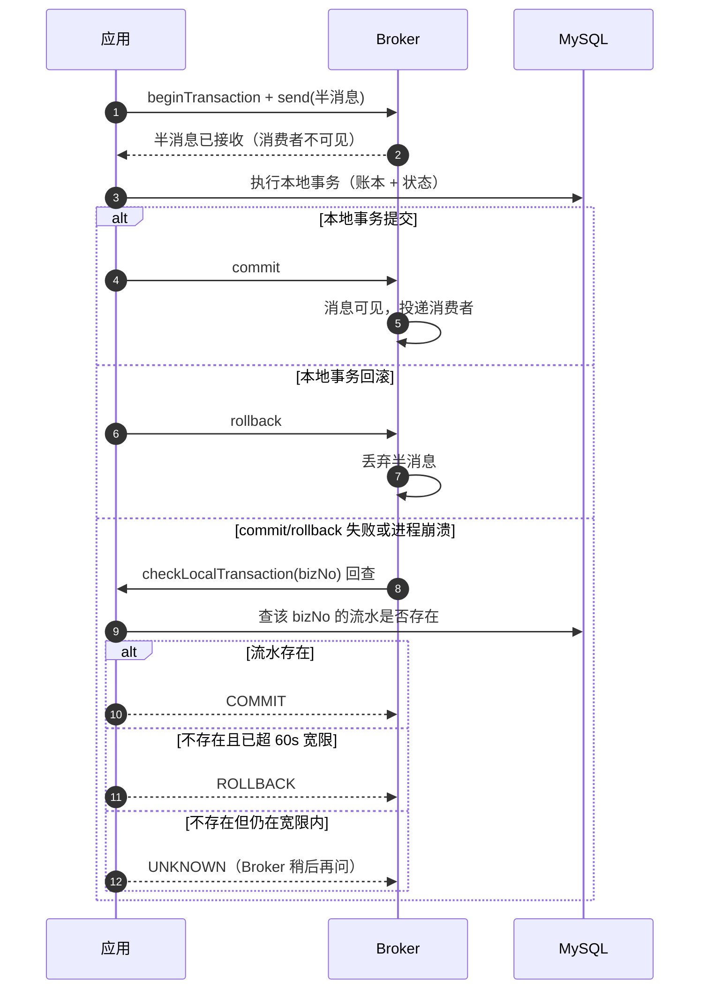

# 消息一致性：本地消息表/outbox 与 RocketMQ 事务消息

> 本文回答一个问题：**本地事务提交了，消息怎么保证一定发出去**。
> 口径：PeerGrab 的现状只写代码能核对到的事实（表名、类名、SQL 条件）；RocketMQ 事务消息部分以离线模块 `peergrab-txmsg-lab` 的实现与验证为依据，**不冒充 PeerGrab 的生产事实**。

## 1. 问题定义

一次资金动作大致是"改状态 + 移动钱 + 通知别人"。前两步在 MySQL 本地事务里能原子完成，第三步是外部 IO（RocketMQ），无法参与本地事务。于是必然出现三类失败：

| 失败模式 | 现象 | 后果 |
| --- | --- | --- |
| 提交成功、消息没发出去 | 进程崩溃 / Broker 不可用 / 网络超时 | 钱动了，下游不知道：通知、信用、对账、推送全缺失 |
| 消息发出、本地事务回滚 | 先发消息后写库，或写库失败 | 下游收到"钱动了"，实际没动；对账直接出差异 |
| 消息重复投递 | MQ 至少一次语义、重试、重发 job | 重复入账或重复计分，除非消费端有幂等键 |

PeerGrab 有**两类消息**，它们的约束不同，因此不能只选一条路线：

| 消息类型 | 例子 | 是否必须延迟 | 当前实现 |
| --- | --- | --- | --- |
| 延迟消息 | 确认超时（5 分钟）、自动结算（24 小时）、缓存延迟双删（500ms） | 是 | `local_message` + RocketMQ 5.x 定时消息 + 扫描兜底 |
| 资金事件 | 结算/退款/仲裁完成后通知下游落库与推送 | 否 | `fund_event_outbox` + 普通 Topic + worker 投递 |

关键事实：**RocketMQ 的事务消息与定时消息互斥**——事务消息不支持 `setDeliveryTimestamp`。所以"需要延迟"的链路根本不可能用事务消息，只能用本地消息表 + 定时消息。这一点决定了分工，不是两套重复实现。

## 2. 两条路线对照

| 维度 | 本地消息表 / outbox | RocketMQ 事务消息 |
| --- | --- | --- |
| 是否需要延迟 | 支持（消息行带 `deliver_at`，配合定时消息） | 不支持定时投递，只能用于即时消息 |
| 与 MQ 可用性的耦合 | 弱：本地事务照常提交，消息留 `PENDING`，MQ 恢复后补投 | 强：半消息发不出去就不能执行本地事务（否则"钱动了事件永远发不出"） |
| 表 / job 数量 | 多表（`local_message`、`fund_event_outbox`）+ 重发 job（`LocalMessageRetryJob`、`FundEventOutboxJob`） | 少表（无需消息表）+ 无需重发 job，但需要回查实现 |
| 回查实现成本 | 无回查；但要写 claim 租约、退避、DEAD 终态 | 必须实现 `TransactionChecker`，且判定依据必须是"只增不减"的事实 |
| 可观测性 | 强：`status`、`retry_count`、`next_retry_at`、`claim_until` 都可查；指标 `peergrab.fund.outbox.pending`、`oldest.age.seconds`、`delay.outbox.dead` | 弱：半消息状态在 Broker 内部，只能靠回查日志与 Broker 控制台 |
| 毒消息处理 | 显式：退避到上限后转 `DEAD`，留人工处置；慢消息不阻塞其他消息 | 无消息表可标记；消费失败靠消费组重试与死信队列，回查侧无"毒消息"概念 |
| 失败模式 | 已提交但客户端超时（S6：Broker 暂停时结算已提交，客户端 8 秒超时）；重复投递 | 半消息成功但本地事务失败 → 回查判 ROLLBACK；commit 失败 → 靠回查；本地事务与消息强绑定 |
| 适用判断 | 需要延迟、要求"MQ 挂了资金也能动"、需要可查询中间态 | 不需要延迟、能接受资金可用性跟随 MQ、团队能写对回查 |

**结论**：PeerGrab 生产用 outbox；事务消息作为对照实验放进离线 lab。这不是"哪个更高级"，而是两条不同的可用性取舍。

## 3. 事务消息：三段式与三态回查

### 3.1 三段式

1. `beginTransaction()` 拿到事务句柄，`send(halfMessage, transaction)` 发出**半消息**——消费者此时看不到。
2. 执行本地事务（写账本、改状态）。
3. 本地事务成功 → `commit()`（消息对消费者可见）；失败 → `rollback()`（消息丢弃）。

第 3 步之前进程崩溃，消息停在半消息状态，Broker 会主动回查："这笔本地事务到底成没成？"



### 3.2 三态回查

| 回查结果 | 判定条件 | 含义 |
| --- | --- | --- |
| `COMMIT` | 该 `bizNo` 的账本流水存在 | 本地事务已提交，消息应当可见 |
| `ROLLBACK` | 流水不存在，且消息年龄 > 60 秒宽限 | 本地事务大概率失败或回滚，丢弃消息 |
| `UNKNOWN` | 流水不存在，但仍在宽限期内 | 事务可能还在提交中，让 Broker 稍后再问 |

伪代码（与 `peergrab-txmsg-lab` 的实现形态一致，PeerGrab 未在生产启用）：

```text
checker(msg):
    bizNo = msg.keys.first()
    if ledgerExists(bizNo):            # 只查只增不减的事实
        return COMMIT
    if now - msg.bornTimestamp > 60s:  # 宽限期
        log.warn("超过宽限仍无流水", bizNo)
        return ROLLBACK
    return UNKNOWN
```

**为什么只查账本流水、不查任务状态**：流水表只增不减，是"这笔钱到底动没动"的确定事实；任务状态会被后续操作改写（结算后又被仲裁、退款、关闭），拿它做判据会在回查时得到错误答案。这是事务消息实现里最容易写错的一处。

**为什么需要 60 秒宽限**：`UNKNOWN` 是"我还不知道"，`ROLLBACK` 是"确定没成"。半消息刚发出、本地事务还在提交路上时，直接判 `ROLLBACK` 会丢掉一条本应投递的消息。

## 4. PeerGrab 的生产事实：为什么保留 outbox

### 4.1 两张表

| 表 | 关键列 | 幂等/并发控制 |
| --- | --- | --- |
| `local_message` | `msg_key`、`topic`、`payload`、`deliver_at`、`status(PENDING/SENT/DEAD)`、`retry_count`、`next_retry_at`、`claim_token`、`claim_until` | `uk_msg_key(msg_key)` 唯一；同一轮超时消息只登记一次 |
| `fund_event_outbox` | `biz_no`（主键，同时是 MQ key）、`event_type`、`amount_cents`、`commission_cents`、`status(PENDING/SENT)`、`claim_token`、`claim_until` | 主键 `biz_no` 与账本业务号同源，天然幂等 |

两张表都是"业务写入与消息登记在同一个本地事务"：`TimeoutTransferStep.enqueueTimeout` 在流转事务里写 `local_message`；`SettleErrandUseCase.settle` 在结算事务里 `fundEventPort.append(event)`。事务提交即"消息一定会被投递"的承诺成立。

### 4.2 两条投递路径

| 路径 | 代码 | 行为 |
| --- | --- | --- |
| 快路径（仅延迟消息） | `TimeoutMessageDispatcher` | 提交后交给有界队列异步发送；队列满或端口不可用时只计数（`peergrab.timeout.dispatch.deferred`），消息仍 `PENDING` |
| 兜底路径 | `LocalMessageRetryJob`（`mqSendScheduler`，10 秒周期 / 10 秒单轮预算）、`FundEventOutboxJob`（2 秒周期 / 10 秒预算） | `claimPending` 批量 100 条，`claim_until` 120 秒租约，逐条同步发送；失败指数退避（上限 5 分钟），1000 次转 `DEAD` |

资金事件**没有快路径**：`JdbcFundEventOutboxAdapter.append` 只做 `INSERT`（类注释写明“只写 outbox；事务边界由调用方持有，投递由 worker 异步完成”），投递延迟上限由 `FundEventOutboxJob` 的 2 秒周期决定。

claim 租约的作用：多个 worker 副本不会重复发同一条；预算耗尽或异常退出时释放未处理租约（`releaseUnprocessedClaims`），避免空占 120 秒。发送成功但标记 `SENT` 失败会导致重复投递——由消费端幂等兜住。

### 4.3 消费端幂等

| 消费组 | 落点 | 幂等键 |
| --- | --- | --- |
| `peergrab-fund-event-consumer` | `notification` | `uk_msg_user(msg_key, user_id)`：重复消费时 `insertIfAbsent` 返回 false，照常 ACK |
| `peergrab-autosettle-consumer` | 结算用例 | 任务 CAS + 托管单 CAS + 账本 `biz_no` 三道闸门；`NOT_DUE`/`ALREADY_SETTLED`/`CONFLICT` 一律 ACK |
| `peergrab-timeout-consumer` | 流转用例 | `version` + `round` + `msg_key` 幂等三件套 |

毒消息策略：自动结算消费者只对"状态已变、再投也不会成功"的错误码（`ILLEGAL_STATE_TRANSITION`、`ERRAND_NOT_FOUND`、`ESCROW_NOT_FOUND`）分类 ACK 并告警，其余返回 `FAILURE` 重投。这样既不会无限重投毒消息，也不会静默丢掉可恢复的失败。

### 4.4 为什么生产不换成事务消息

1. **可用性方向**：PeerGrab 是单 ECS 演示站，Broker 与应用同机；把资金动作绑到 Broker 可用性上，会让"Broker 重启"变成"不能结算"。
2. **需要延迟**：四条 Topic 里三条是 `DELAY` 类型（确认超时、自动结算、缓存失效），事务消息根本用不了。
3. **可查询**：`PENDING` 积压、最老消息年龄、`DEAD` 数量都能直接查库与出指标，排障成本最低。
4. **已有兜底**：扫描通道让"MQ 完全不发"也能把状态推到终态，只是慢（S5：MQ 9.512 秒 vs 扫描 25.100 秒，P99）。

代价也认账：多两张表、两个 job、多一段 claim 逻辑；Broker 暂停时"结算已提交但客户端 8 秒超时"的体验问题需要前端幂等键（`X-Request-Id`）兜住。

### 4.5 排障入口

| 指标 | 含义 | 异常时先看什么 |
| --- | --- | --- |
| `peergrab.fund.outbox.pending` | `fund_event_outbox` 中 `PENDING` 行数 | Broker 是否可达、`FundEventOutboxJob` 是否在跑、claim 是否被长期占用 |
| `peergrab.fund.outbox.oldest.age.seconds` | 最老 `PENDING` 消息的年龄 | 持续增长说明投递通道整体失败，而不是个别毒消息 |
| `peergrab.delay.outbox.pending` | `local_message` 中 `PENDING` 行数 | 延迟消息是否堆积；配合 `timeout.dispatch.deferred` 看即时发送是否被延后 |
| `peergrab.delay.outbox.dead` | `local_message` 中 `DEAD` 行数 | 需要人工检查 payload 与消费端错误；当前没有自动重放工具 |
| `peergrab.recon.diffs.today` | 当日 `recon_diff` 行数 | 任何非 0 都要当作 bug 查，不是"允许的小误差" |

这些指标都由 worker 的 `WorkerOperationalMetrics` 直接从表里 `COUNT(*)` 刷新，所以指标本身就是"数据库状态的投影"——这也是 outbox 相对事务消息最实用的差别：**状态在库里，排障不用猜 Broker 内部发生了什么**。

## 5. 离线 lab：`peergrab-txmsg-lab`（已入库）

位置 `peergrab-backend/peergrab-txmsg-lab`（父 pom 的 `<modules>` 第 10 项），与 `peergrab-sharding-lab` 同级，**不进入 API/worker 运行包，也不引入 MQ 客户端依赖**：它用内存 Broker 仿真协议语义，把“事务消息”从概念变成可执行规格。

| 类 | 作用 |
| --- | --- |
| `InMemoryTransactionBroker` | 半消息（`PREPARED`）→ commit/rollback → 三态回查；`CHECK_BACK_GRACE=60s`，超宽限转 `DISCARDED`；`sendMessageInTransaction` 固化“半消息失败则不执行本地事务” |
| `TransactionMessage` / `TransactionMessageStatus` | 消息与状态（`PREPARED`/`COMMITTED`/`ROLLED_BACK`/`DISCARDED`） |
| `TransactionResolution` | 三态结论 `COMMIT`/`ROLLBACK`/`UNKNOWN` |
| `TransactionChecker` / `LedgerFactChecker` | 回查接口与“只查账本事实”的实现（事实存在 `COMMIT`，否则 `UNKNOWN`） |

`TransactionMessageLabTest` 的六个可执行场景：

| 测试方法 | 验证的协议事实 |
| --- | --- |
| `committedMessageBecomesVisibleExactlyOnce` | 半消息不可见；commit 后恰好投递一次；重复 commit 幂等 |
| `rolledBackMessageIsNeverVisible` | 回滚不可见、不可投递、不可再 commit；已回滚不再回查 |
| `checkBackCommitsWhenLedgerFactExistsEvenIfCommitCallWasLost` | commit RPC 丢失但账本有流水 → 回查 `COMMIT`，且只投递一次 |
| `checkBackStaysUnknownWithinGraceThenRollsBackAfterGrace` | 30 秒时 `UNKNOWN`；61 秒后 `ROLLBACK` 并转 `DISCARDED` |
| `localTransactionIsNotExecutedWhenHalfMessageSendFails` | 半消息失败 → 本地事务回调未执行、无落盘、无投递 |
| `checkerOnlyDependsOnInjectedLedgerFactNotMutableMessageStatus` | 四种消息状态下都只看账本事实；事实缺失返回 `UNKNOWN` 而不是武断 `ROLLBACK` |

**lab 与常见实现的一个差异**：常见实现让回查器自己在超过 60 秒宽限时返回 `ROLLBACK`；本 lab 把“超时判定”交给 Broker（`LedgerFactChecker` 只返回 `COMMIT`/`UNKNOWN`，超宽限由 `InMemoryTransactionBroker` 丢弃）。两种写法都能收敛，区别是责任位置：Broker 侧让 checker 保持纯函数、易单测；checker 侧更直观，但容易把“查不到”误判成“失败”。

**lab 不验证什么**：不验证网络、序列化、Topic 类型、ACL 与真实 Broker 的 15 次回查上限；这些属于 §6“真实 RocketMQ 5.x 落地坑”的范围。outbox vs 事务消息的真机对照数据仍为 `[待补充]`。

## 6. 真实 RocketMQ 5.x 落地坑

| 坑 | 现象 | 处理 | 归属 |
| --- | --- | --- | --- |
| `TransactionChecker` 必填 | `beginTransaction` 抛 `Transaction checker should not be null` | 构建 Producer 时注册 checker；5.x gRPC 客户端把它做成 `TransactionChecker` 而非 4.x 的 `TransactionListener` | 离线 lab 复盘 |
| Topic 必须是 `TRANSACTION` 类型 | 事务消息发到 NORMAL topic 被 Broker 拒绝 | 建 topic 时 `-a +message.type=TRANSACTION`；`init-mq.sh` 需同步 | 离线 lab 复盘；PeerGrab 的 `init-mq.sh` 目前只建 `DELAY`/`NORMAL`，没有 `TRANSACTION` |
| commit 失败不能回滚本地事务 | commit 抛异常时本地事务已提交 | 只记日志，交给 Broker 回查；不能在 catch 里反向回滚 | 离线 lab 复盘 |
| 回查只查流水 | 用任务状态做判据会误判 | 只查 `wallet_ledger.biz_no`（只增不减） | 离线 lab 复盘 |
| 事务消息不支持定时 | `setDeliveryTimestamp` 与事务互斥 | 需要延迟的链路只能 outbox + 定时消息 | PeerGrab 现状（四条 Topic：三条 DELAY、一条 NORMAL） |
| Producer 不预绑定 topic | 预绑定会让 broker 重建后应用启动失败（实测踩过） | `RocketMqConfig.timeoutProducer` 不调 `setTopics`，路由首次发送时惰性获取 | PeerGrab 现状（代码注释明确记录） |
| 半消息发出但事务没执行 | 资金没动，事件却可能被 commit | 半消息失败即放弃本地事务；事务结果决定 commit/rollback | 离线 lab 复盘 |
| 消费端不能依赖 MessageID | 重投后 MessageID 可能变化 | 用业务唯一键（`biz_no`/`msg_key`）做幂等 | PeerGrab 现状 |

> 边界：上表把"PeerGrab 生产现状"与"离线 lab 复盘"分开标注。写文档时不要把自己没跑过的实现说成现状。

## 7. 决策记录

- **保留 outbox**：延迟消息占多数、单机 Broker、需要可查询中间态、演示站不能因 Broker 重启停止结算。
- **不引入事务消息到生产**：收益（少两张表）小于代价（资金可用性跟随 MQ、回查写错就丢消息、与定时消息互斥）。
- **用 lab 保留对照**：协议、三态回查、故障注入都有教学价值；lab 不进入运行包，避免"未接线能力被误读为已上线"。
- **什么时候重新评估**：如果出现"资金事件量远超延迟消息"或"必须多库部署"或"Broker 成为独立高可用集群"三种情况之一，事务消息的可用性耦合代价会下降，届时用 lab 的实测数据重新决策。

相关文档：[设计基准](design-benchmark.md)（§5.4 消息一致性矩阵、§4.4 延迟队列矩阵）、[架构设计与技术选型](架构设计与技术选型.md)（§4.5 异步与消息）、[配置参考](config-reference.md)（`mq.*`、`message.*`、`fund-outbox.*`）。
