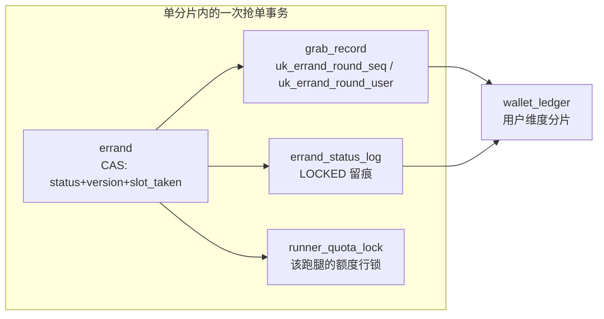

# 分片设计：为什么按 campus_id 切，共片换来了什么

> 结论先行：PeerGrab 的**规则层**按 `campus_id` 分片（任务共片 4 张表）+ 按用户维度分片（账户/流水/信用 4 张表），其余 14 张表不分片；**运行链路尚未接线**，单库单表仍是唯一事实形态。
> 本文只写能在 `peergrab-backend/peergrab-sharding-lab`、`docker/init.sql` 里核对到的规则与列，不写"已分片"的结论。

## 1. 查询画像决定分片键

`errand` 表上的读写按频率排：

| 查询 | 频率 | 条件 | 分片后的路由 |
| --- | --- | --- | --- |
| 广场列表（某校区 PUBLISHED 任务，游标分页） | 最高（所有用户反复刷） | `campus_id + status + created_at` | 单分片 |
| 任务详情 | 高 | `id`（请求上下文自带校区） | 单分片（补 `campus_id`） |
| 抢单 CAS | 高写 | `id + status + version` | 单分片 |
| 我的发布 / 我的接单 | 低 | `publisher_id` / `grabber_id` | 跨片（低频，可接受） |
| 超时/结算扫描（worker） | 极低 | `status + deadline` | 广播所有分片 |

读流量被"广场列表"统治，而它天然带校区条件——学生只刷自己校区的广场，跨校区浏览在这个业务里不存在。写流量全是单行操作（CAS、状态流转），单行在哪个分片方案下都只落一片，不受分片键影响。

### 1.1 选型排除法

| 候选 | 优点 | 为什么不够 |
| --- | --- | --- |
| `errand_id` 哈希 | 写入最均匀，教科书答案 | 广场列表没有 `errand_id`，只能广播所有分片再内存归并排序——把最高频查询打成最慢查询 |
| `publisher_id` | "我发布的任务"变快 | 这是低频页；广场列表照样广播全部发单人分片，比 `errand_id` 更差 |
| `user_id` | 与账户/信用维度一致 | 发单人和跑腿是两个人，一个任务无法只落在一个用户分片；抢单记录与托管单会被撕成两片 |
| `campus_id`（终选） | 广场单分片、详情/抢单可路由、业务隔离线与分片线重合 | "我的任务"与全局统计跨片；单校区热点需二级拆分 |

### 1.2 两个只有 campus_id 才成立的理由

1. **业务隔离边界与分片边界重合**：东校区的学生不会抢西校区的单，任务、抢单、托管整条链路封闭在一个校区内。分片最痛的是"业务非要跨片"，而这个业务在领域模型层面就按校区隔离——分片键顺着业务隔离线切，跨片缝合成本天然为零。
2. **共片需要一把公共钥匙**：`grab_record`、`escrow_order`、`errand_status_log` 必须与 `errand` 共片（理由见 §2）。能把"任务 + 抢单记录 + 托管单 + 状态日志"串在同一分片的维度只有校区：`errand_id` 串得起来但列表查询会崩，`user_id` 根本串不起来。

## 2. 共片的四个理由

### 2.1 按 errand_id 反查的路由

分片后 `WHERE errand_id = ?` 不含分片键，ShardingSphere 只能广播所有分片。所以这些表补 `campus_id` 后，查询必须写成 `WHERE campus_id = ? AND errand_id = ?`。

`peergrab-sharding-lab` 把这条纪律写成了测试：`PeerGrabShardingPolicyTest.productionSqlDoesNotQueryTaskBindingTablesByErrandIdOnly` 扫描 `peergrab-infrastructure/src/main/java` 的全部 Java 源码，断言不存在 `FROM grab_record WHERE errand_id = ?`、`FROM escrow_order WHERE errand_id = ?`、`UPDATE escrow_order SET status = ? WHERE errand_id = ?`、`FROM errand_status_log WHERE errand_id = ?` 这四种写法。它守的不是"当前实现"，而是"以后别写回去"。

### 2.2 Binding table join

抢单与结算链路有高频 join（任务 ⋈ 抢单记录、任务 ⋈ 托管单）。ShardingSphere 的 binding table 要求同分片键，join 才能下推到单分片；否则要把两片数据拉到内存归并。

`PeerGrabShardingRuleFactory` 用 `ShardingTableReferenceRuleConfiguration("task_binding", "errand,grab_record,escrow_order,errand_status_log")` 声明了这组绑定，四张表统一用 `campus_id` 作分片列。

### 2.3 唯一索引只在单分片内生效（最致命的一条）

MySQL 的唯一索引**只在单表/单分片内有效**。`grab_record` 的两道防线：

```sql
UNIQUE KEY uk_errand_round_seq  (errand_id, round, seq)
UNIQUE KEY uk_errand_round_user (errand_id, round, runner_id)
```

如果 `grab_record` 与 `errand` 不共片，同一个 `errand_id` 理论上可能落到两个分片，两条记录各自在自己的分片里"唯一"——**INV-1（零超卖）直接失效**，而这正是项目最核心的卖点。只有按 `campus_id` 与 `errand` 共片，"同一个任务必然在同一个分片"，唯一约束才继续全局有效。这也是 §5.3 里"结算跨片事务"必须单独认账、而抢单事务绝不能跨片的原因。

### 2.4 抢单事务收敛为单分片本地事务

抢单事务要同时写三张表：`errand`（CAS 占名额）、`grab_record`（插记录）、`errand_status_log`（留痕）。三张表共片 → 仍是普通本地事务，与现在单库行为一致；不共片 → 必须上 ShardingSphere 的 XA/FlexiTransaction，故障面与复杂度完全不是一个量级。



注意箭头 `grab_record → wallet_ledger` 是跨维度的：抢单事务里的 `ensureUserAccount` 会碰用户账户。当前它被刻意放在同一事务内以保证"抢中即有账户"，分片后这一步必须移出或改为广播表（见 §5.3）。

## 3. 补与不补 campus_id 的清单

22 张表按分片归属分三类：

| 表 | 分组 | 分片键 / 处理 | 理由 |
| --- | --- | --- | --- |
| `errand` | 任务共片 | `campus_id` | 分片锚点 |
| `grab_record` | 任务共片 | `campus_id` | 按 `errand_id` 反查 + 双唯一索引 + 抢单事务 |
| `escrow_order` | 任务共片 | `campus_id` | 结算按 `errand_id` 查、`casEscrowStatus` 已带 `campus_id` |
| `errand_status_log` | 任务共片 | `campus_id` | 与状态流转同事务写入、时间线按任务查 |
| `wallet_account` | 用户维度 | `owner_id` | "我的余额"；系统户 `-1`/`-2` 是特例 |
| `wallet_ledger` | 用户维度 | `user_id` | "我的流水"，按时间游标分页 |
| `credit_score` | 用户维度 | `user_id` | 信用是人的维度，不是校区维度 |
| `credit_event` | 用户维度 | `user_id` | 同上；排行榜本来就在 Redis ZSET |
| `runner_quota_lock` | 不补 | 广播/单表 | 主键是 `runner_id`，抢单时按跑腿加锁，不按校区 |
| `publish_request` | 不补 | 广播/单表 | 主键 `(publisher_id, request_id)`，发布幂等与校区无关 |
| `auth_token_session` | 不补 | 广播/单表 | 鉴权按 `session_id` 点查，全局唯一 |
| `auth_refresh_token` | 不补 | 广播/单表 | 同上，按 `token_hash` 点查 |
| `local_message` | 不补 | 广播/扫描 | worker 按 `status + next_retry_at` 扫，跨片是设计前提 |
| `fund_event_outbox` | 不补 | 广播/扫描 | 同上，按 `status + next_retry_at` 扫 |
| `snowflake_node_lease` | 不补 | 广播表 | 节点号全局唯一，必须单点事实 |
| `fund_audit_log` | 不补 | 广播/后续补 | 按 `biz_no`/`errand_id` 查，审计低频；分片后查询广播可接受 |
| `notification` | 不补 | 按 `user_id` 查 | "我的消息"，用户维度已足够 |
| `recon_diff` | 不补 | 广播 | 全局对账，本来就跨全部分片 |
| `sync_diff` | 不补 | 广播/后续补 | 缓存校验 job 按 `errand_id` 抽样，低频 |
| `worker_scan_retry` | 不补 | 广播 | 主键 `(job_type, errand_id)`，扫描失败重试，低频 |
| `bench_run` / `bench_run_item` | 不补 | 单表 | 压测轮次元信息，与业务分片无关 |

**为什么 `fund_audit_log`、`sync_diff`、`worker_scan_retry` 不补**：它们的查询都带 `errand_id`，理论上补 `campus_id` 能精确路由；但三者都是后台低频路径（审计查询、抽样校验、失败重试），广播的代价可接受，而补列要改写入方与迁移脚本。这是刻意留的"以后再说"，不是遗漏。

## 4. 代价认账

1. **全局统计跨片**：全校区总单量、总流水要跨片聚合。结论是不走在线查询，走离线 job/报表；在线接口不提供"全平台实时总览"。
2. **单校区热点**：某个校区量级碾压其他校区时会出现大分片。对策是 `campus_id + hash` 二级拆分，分片键前缀不变，路由规则可平滑升级；当前规模不触发。
3. **结算链路跨片**：`errand`（校区片）× `wallet_ledger`（用户片）是**已知边界**，补什么列都消不掉。三种应对：① 把 `ESCROW`/`COMMISSION` 系统户设为广播表或单分片，结算事务退化为"用户分片 + 广播表"的准本地事务；② 接受跨片事务（XA/FlexiTransaction）；③ 把结算拆成"任务侧出账 + 资金侧入账"两段，用 outbox 与对账兜底。**当前不选任何一种**，因为它们都改变资金事务的语义，而单库下这个问题不存在。
4. **"我的任务"跨片**：`listByRunner` 按 `grabber_id` 查，分片后要么广播，要么维护按用户的投影表。当前该接口已改为按当前 `grabber_id` 归属并补了 `idx_grabber_created`，单库下没问题。
5. **扫描 job 广播**：`TimeoutScanJob`/`AutoSettleScanJob` 按 `status + deadline` 扫，无校区上下文，分片后必然广播。低频后台任务，接受。

## 5. 现状与接线步骤

### 5.1 现状

| 项 | 状态 |
| --- | --- |
| 规则层 | `peergrab-sharding-lab` 已有 `PeerGrabShardingPolicy`（路由规格）、`PeerGrabShardingRuleFactory`（规则工厂）、`PeerGrabModuloShardingAlgorithm`（class-based 取模算法），两个测试类覆盖规则与 SQL 纪律 |
| 依赖 | ShardingSphere 5.5.2 只出现在 `peergrab-sharding-lab/pom.xml` 与父 pom 的 `dependencyManagement`；`bootstrap`/`worker` 的 `application.yaml` 里没有 `spring.shardingsphere` |
| 列 | `docker/init.sql` 已有 4 处 `campus_id`（`errand`、`errand_status_log`、`grab_record`、`escrow_order`），历史库由 `docker/migrate-p6.sql` 补列 |
| 运行链路 | **未接线**：数据源仍是单库单表，`PeerGrabModuloShardingAlgorithm` 只被测试调用 |

### 5.2 接线步骤（未来）

1. **依赖与数据源**：在 `bootstrap`/`worker` 引入 sharding-jdbc，把单数据源改为分片数据源；`peer_grab_0..N` 物理库与连接池参数进配置。
2. **规则装配**：把 `PeerGrabShardingRuleFactory.create(n)` 的结果接到 Spring 的 `ShardingRuleConfiguration`；分片数 `n` 必须是显式配置项，不能从节点名推断。
3. **端口签名**：一部分方法已经带 `campusId`（`GrabRecordRepository.findGrabbedByRequestId`、`WalletRepository.findEscrowByErrandId`、`casEscrowStatus`），另一部分仍是单键（`ErrandRepository.appendStatusLog`、`casLockForRunner`、`casTransferToNext`），接线时后者要补 `campusId`。领域规则不动，改的是 adapter 与端口签名。
4. **SQL 补齐**：所有任务共片表查询与 CAS 都带 `campus_id`；`casEscrowStatus` 已经是这个形态，可作为模板。门禁就是 lab 里那条扫描测试。
5. **扫描 job**：明确"广播"还是"按片拆分"。广播最省事，但每轮成本 × 分片数；按片拆分需要游标带上片号。
6. **资金链路**：先决定 §4.3 的三种应对，再动代码；在决定之前不要接线，否则会得到"跨片事务 + 单库假设"的混合体。
7. **数据重分布**：按 `campus_id` 把单库数据迁到 `peer_grab_N`，用 `migrate-p6.sql` 的补列结果做路由；迁移脚本必须可重复执行。

### 5.3 风险

| 风险 | 表现 | 缓解 |
| --- | --- | --- |
| 唯一索引失效 | 任务共片表被误路由到两片，`uk_errand_round_seq` 不再全局唯一 → 超卖 | 共片绑定 + lab SQL 纪律测试 + 分片键不可空约束 |
| 跨片事务 | 结算改状态与过账不在一个本地事务，失败后资金与状态不一致 | 先定 §4.3 方案；对账 L1/L3 兜底；迁移期双跑校验 |
| 广播放大 | 扫描/校验/统计在 N 片各跑一遍 | 后台任务限频 + 时间预算 + 只保留必要广播 |
| 路由遗漏 | 某条 SQL 漏 `campus_id`，单库测试全绿、分片后广播或报错 | lab 的源码扫描测试扩展到新增适配器 |
| 系统户热点 | 旧共享 `ESCROW`/`COMMISSION` 单行锁在分片后仍在（广播表更集中） | 2026-10 已改为每单托管户/佣金户，全局系统户串行点消失；分片后仍需关注每单账户与 runner/user 钱包 |

**验收门禁**（接线时必须同时满足）：`peergrab-sharding-lab` 全部测试通过、`-Dpeergrab.it=true` 的 IT 在分片栈上通过、L1/L2/L3 对账差异为 0、抢单 S1 场景仍严格 1 人成功 0 超卖。

相关文档：[设计基准](design-benchmark.md)（§8 数据模型、§10 演进）、[架构设计与技术选型](架构设计与技术选型.md)（§9 已知边界第 5 条）、[配置参考](config-reference.md)、[后端 README](../../peergrab-backend/README.md)（分片未接线的表述）。
