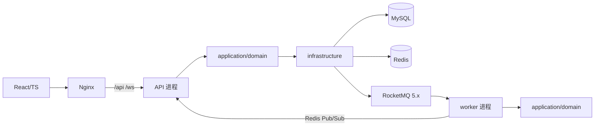

# PeerGrab 架构设计与技术选型

PeerGrab 是校园跑腿交易平台：发布悬赏、资金托管、并发抢单、履约结算、退款与仲裁。本文只写当前代码里能核对到的架构、取舍与边界；逐条论证、方案矩阵与指标口径见[设计基准](design-benchmark.md)，配置项见[配置参考](config-reference.md)，部署与迁移见[单机部署说明](../../peergrab-backend/docker/ECS_DEPLOY.md)。

> 数字口径：本文不新造性能数字。引用到的实测值均来自 [README](../../README.md) 与 `peergrab-backend/bench/reports/`，并注明出处。

## 1. 运行形态

- **模块化单体**：一个 Maven 多模块工程，按六边形分层，domain 只依赖 JDK；模块边界由 ArchUnit 测试守。
- **双进程**：API（`peergrab-bootstrap`，8080）与 worker（`peergrab-worker`，8082）复用 `application`/`domain`，只装配不同的适配器与调度器；Nginx 同源提供前端与 `/api`、`/ws`。
- **单实例依赖**：单 MySQL 库、单 Redis、单 RocketMQ（proxy 8081），当前部署在单台 ECS；扩容边界见第 9 节。
- **离线实验（均不进入运行包）**：`peergrab-bench` 是压测客户端；`peergrab-sharding-lab` 是 ShardingSphere 规则实验，ShardingSphere 5.5.2 依赖只声明在该模块的 pom 里，`bootstrap`/`worker` 的 yaml 没有 `spring.shardingsphere` 配置；`peergrab-txmsg-lab` 用内存 Broker 仿真 RocketMQ 事务消息协议、不引入 MQ 客户端依赖（协议与验收场景见[消息一致性](messaging-consistency.md)）。离线模块独立成 Maven 模块，是为了让未接线能力可测试、又不被误读为已上线。

## 2. 模块与依赖边界

| 模块 | 职责 | 进入运行包 |
| --- | --- | --- |
| `peergrab-shared` | 值对象、错误码、雪花 ID、MQ 消息协议、实时事件协议 | API 与 worker |
| `peergrab-domain` | 状态机、聚合规则、端口；纯 JDK，不依赖 Spring | API 与 worker |
| `peergrab-application` | 发布、抢单、履约、结算、退款、仲裁用例与编排 | API 与 worker |
| `peergrab-infrastructure` | MySQL、Redis、RocketMQ、限流、鉴权适配器 | API 与 worker |
| `peergrab-presentation` | REST、WebSocket、DTO、鉴权入口 | 仅 API |
| `peergrab-bootstrap` | API 进程装配与集成测试 | 仅 API |
| `peergrab-worker` | 延迟流转、自动结算、补偿、校验、对账、保留清理 | 仅 worker |
| `peergrab-bench` | 实验客户端与探针 | 否 |
| `peergrab-sharding-lab` | 分片规则离线验证（路由策略、规则工厂、取模算法） | 否 |
| `peergrab-txmsg-lab` | 事务消息协议仿真（内存 Broker、三态回查），与 outbox 对照；不进入运行包 | 否 |

依赖方向固定为 presentation/bootstrap/worker → application → domain；infrastructure 实现 domain 端口。ArchUnit 检查"domain 不依赖框架、端口位置、model 不依赖 ports"。

## 3. 数据与事务

- MySQL 单库事务同时承载任务状态、托管单、账户与复式分录、本地消息表、资金事件 outbox、通知、雪花节点租约、MySQL 真值的 JWT 会话表。
- 金额以整数分存储；托管单与流水靠业务号唯一索引幂等；状态迁移用 `status + version` CAS。
- 缓存、Redis 名额、MQ 都是**可重建或可补偿**的派生状态，权威数据只在 MySQL。
- `docker/init.sql` 用于全新卷；已有卷只执行 `migrate-runtime.sql` 与 `migrate-query-indexes.sql`，不会重跑 init。

## 4. 核心链路与实现要点

### 4.1 发布即托管

任务、托管单、发单人扣款、托管账户入账与分录在同一事务提交；发布接口强制要求 `X-Request-Id`，命中 `publish_request` 唯一键时返回原任务，避免重试重复建单。发布前用 `WalletRepository.ensureUserAccount` 幂等开通账户，提交后再登记 Bloom 并做缓存失效。

### 4.2 抢单裁决

统一口径：**四层防护（限流 → 资格 → Lua → DB CAS）+ 双唯一索引**。鉴权、`ActorRolePolicy` 角色校验、发单人不能抢自己的单是抢单之前的独立前置，不计入“层”。

- L1 限流：`SentinelGrabRateLimiterAdapter` 按 `errandId` 热点参数限流（`grab.limit.*`）。
- L2 资格：读后端 `credit_score` 与在途数（`credit.min-score` / `credit.max-ongoing`），不信任客户端传分。
- L3 Lua：Redis 原子预占名额，requestId 幂等、同用户防重。
- L4 DB CAS：`casLockForRunner` 以 `status` + `version` + `slot_taken<slot_total` 终裁；`grab_record` 的 `uk_errand_round_seq` / `uk_errand_round_user` 是零超卖的最后防线。

Redis 不可用或名额键丢失时降级为数据库 CAS（内部 `SlotOutcome.SLOT_MISSING`，不对外暴露错误码）；候选队列、名额、idem 快照都在 Redis，允许丢失。论证与候选方案矩阵见[设计基准](design-benchmark.md)。

### 4.3 超时递补与回退

确认超时先尝试候选队列；`errand.transfer_count` 单独记录连续递补次数，回退时归零，避免触及轮次上限后候选永久失效。回退提交后重建 Redis 名额键。若数据库已是 `PUBLISHED` 而 Redis 仍留有 `grabbed`/idem 快照，抢单路径会清理陈旧快照，防止进程崩溃后长期误判 `ALREADY_GRABBED`。

### 4.4 结算、退款与仲裁

结算用任务状态 CAS、托管单状态 CAS、流水业务号唯一键防重复入账；批量结算按页处理并受时间预算约束。`ensureUserAccount` 在抢单事务内以及结算/退款/仲裁前幂等开通用户账户，避免"无账户身份"在结算时中毒；批量账户更新后回读校验。提交后的审计、榜单、缓存、推送副作用逐项隔离，单项失败只计数告警。

自动结算消息可能早于数据库截止时间到达：用例返回 `NOT_DUE`，消费者 ACK，由 5 秒扫描在到期后兜底。

### 4.5 异步与消息

- 主通道：RocketMQ 5.x 延迟消息（确认超时、自动结算、缓存失效）与普通 Topic 的资金事件 outbox。
- 兜底：数据库扫描（超时、自动结算、本地消息重发、outbox 投递），扫描带宽限期，让 MQ 主通道先处理。
- 隔离：MQ 同步发送在独立 `mqSendScheduler`；`LocalMessageRetryJob`/`FundEventOutboxJob` 单轮时间预算 10 秒；`RocketMqDelayMessageAdapter.available()` 在发送失败后冷却 5 秒，避免 Broker 黑洞拖垮兜底扫描。
- 配置接线：`mq.topic.confirm-timeout/auto-settle/cache-evict/fund-event` 同时驱动发送端与消费端，不再有"发到 A、订阅 B"的常量漂移。

### 4.6 缓存与 Redis

- 详情：Cache Aside + 逻辑过期 + 互斥重建 + 空值缓存 + TTL 抖动。
- 防穿透：Bloom 判否短路；发布登记 3 次退避重试，每 30 分钟全量校准，重建期间撤销 READY 使读路径 fail-open，另有 1% 判否抽样审计。
- 一致性：提交后删除 + 延迟双删（发送池有界）+ 抽样一致性校验（含负值缓存核对）。
- Redis 生产使用 `allkeys-lru`：缓存、名额、Bloom、榜单、Pub/Sub、本机演示的 auth session 都可重建；名额槽位被淘汰时由 MySQL CAS 兜底。

### 4.7 实时推送

`shared/RealtimeEvents` 统一 `{type,payload}` 与 `instanceId|userId|payload` 信封，频道为 `peergrab:realtime:events`。API 持有 WebSocket，worker 用 `RedisFanoutRealtimeNotifier` 发布到同一频道；资金事件实时推送并入 worker 的落库消费者（原 `peergrab-fund-event-push` 组退役）。递补与回退也有实时通知。

## 5. 身份与角色

- 没有用户表：身份来自 token（生产为 MySQL 真值 JWT，本机演示为 Redis session），仲裁员由 `peergrab.auth.arbitrator-id` 指定。
- `ActorRolePolicy` 禁止仲裁员发布与抢单；仲裁用例二次校验仲裁员不得为当事人；`ArbitrationFavor.fromWire` 严格解析 `RUNNER/PUBLISHER`，非法值返回 `INVALID_ARGUMENT`。
- 登录失败由 `LoginAttemptGuard` 在进程内按 IP+userId 限速（默认 5 次/60 秒窗口、锁 300 秒）；登录响应带 `role`（`ARBITRATOR`/`USER`）。
- 9001 仲裁员与四个演示口令只用于公开演示；生产需关闭 demo 并接真实身份。

## 6. 账务视图

钱包流水返回 `accountType`（`USER`/`ESCROW`/`COMMISSION`），前端标注平台账户动作不代表个人余额变动；净额与托管闭环由对账任务按借贷平衡、余额快照核对。

## 7. 可观测性与测试门禁

- 指标：API 与 worker 暴露 `/actuator/prometheus`，含 JVM、HTTP、Hikari、`Result.code` 业务结果、资金 outbox 积压与老化、延迟消息、对账差异、双删失败。
- 看板：[`docker-compose.observability.yaml`](../../peergrab-backend/docker/docker-compose.observability.yaml) overlay（`--profile observability`），Prometheus `127.0.0.1:29090`、Grafana `127.0.0.1:23000`；规则覆盖 up、outbox 积压/老化、延迟消息/dead、对账差异、双删失败、API 非 OK 比例与 `INTERNAL_ERROR`，说明见[可观测性 README](../../peergrab-backend/docker/observability/README.md)。
- 门禁：单测默认执行；IT 必须 `-Dpeergrab.it=true`，此时中间件不可用会失败（`MiddlewareAvailable.require`），本地无中间件时 IT 类由 `@EnabledIfSystemProperty` 不执行。

## 8. 技术选型与取舍

| 选择 | 理由 | 代价与边界 |
| --- | --- | --- |
| 模块化单体（非微服务） | 资金链路需要同库事务；单 ECS 运维持成本低 | 只能按进程横向扩，领域边界靠 ArchUnit 与评审守 |
| MySQL 单库 | 任务、账本、outbox 一次提交；对账简单 | 共享账户行锁压制结算吞吐；短批次实测 32.04–39.52 TPS（口径见[设计基准](design-benchmark.md)） |
| Redis | Lua 原子预占、候选队列、缓存、Bloom、Pub/Sub、榜单 | 可丢数据；生产 `allkeys-lru`，槽位丢失回退 DB CAS |
| RocketMQ 5.x | 延迟消息与消费组重试现成 | 单 Broker；Broker 故障时靠扫描兜底，实时性下降 |
| JWT + MySQL 会话 | Redis 故障仍能校验已签发令牌 | 每请求查会话，用 `resolve-cache-ms` 本地缓存缓解 |
| 自建虚户 + 复式记账 | 不接支付也能表达托管、佣金、退款 | 非持牌托管，只做内部账账对账 |
| 纯抢单 + 超时递补 | 规则可解释、可压测 | 无智能派单，无风控反作弊 |

## 9. 已知边界

1. 纯抢单 + 超时递补，没有智能派单与路径优化。
2. 自建虚户不是持牌托管；资金只做内部账账对账，不接银行或支付流水。
3. 共享 `ESCROW`/`COMMISSION` 账户行锁，批量结算放大锁持有；短批次结算 32.04–39.52 TPS，均为秒级批次而非稳态容量（口径见[设计基准](design-benchmark.md)）。
4. 单 ECS、单 MySQL/Redis/Broker；`docker-compose.distributed.yaml` 只描述多主机形态，不提供中间件高可用。
5. 单名额（`slotTotal=1`）；分片规则只在 `peergrab-sharding-lab` 验证，未进运行链路；接线步骤与跨片边界见[分片设计](sharding-design.md)。
6. 无 tracing、无日志聚合、无 Alertmanager；指标只有 `/actuator/prometheus` 已暴露的部分。
7. 公开演示口令与仲裁员 9001 仅演示；生产需关闭 demo 并接真实身份与风控。

## 10. 文档地图

| 文档 | 内容 | 何时读 |
| --- | --- | --- |
| [设计基准](design-benchmark.md) | 四条链路的不变式、代码落点、方案演进矩阵、指标口径、明确不做什么 | 改设计或做评审时先读 |
| [消息一致性](messaging-consistency.md) | 本地消息表/outbox 与 RocketMQ 事务消息的对照、三段式与三态回查、离线 lab 场景 | 改异步或新增事件时 |
| [分片设计](sharding-design.md) | 为什么按 `campus_id` 分片、共片四理由、补列清单、接线风险 | 谈扩容/分片时 |
| [配置参考](config-reference.md) | 全部 `peergrab.*` 键、共享键矩阵、生效进程 | 改配置或排查行为差异 |
| [设计演进](../engineering/design-evolution.md) | 方案如何一步步演进到今天 | 想知道以前为什么不是这样 |
| [评测方法论](../benchmark/methodology.md) | 场景设计、隔离纪律、证据与口径 | 读任何性能数字之前 |
| [文档索引](../README.md) | 全仓库文档入口 | 第一次进入文档体系 |
| [后端 README](../../peergrab-backend/README.md) / [压测手册](../../peergrab-backend/bench/README.md) | 启动、测试与实验边界；隔离栈与场景入口 | 跑起来 / 自己复测 |

> `docs/README.md`、`docs/engineering/design-evolution.md`、`docs/benchmark/methodology.md` 由并行任务创建；在它们落盘前，上述链接指向约定路径。
